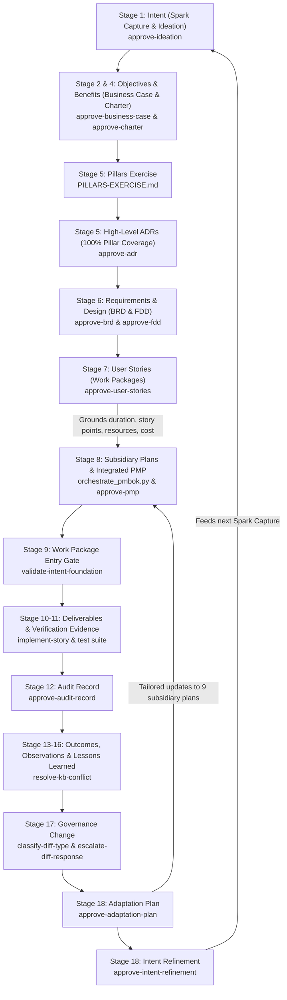

# SIDPA Template

**Synthetic Intent-Driven Process Architecture (SIDPA)**

A reusable, production-grade scaffold for the closed-loop governance-and-build methodology developed across `agent-learning`, `ADPA`, and `SocialEngage`. SIDPA establishes a formal, verifiable trace from strategic motivation through delivery, quality auditing, governance evolution, behavioral adaptation, and refined intent:

$$\text{Spark} \longrightarrow \text{Ideation} \longrightarrow \text{Business Case} \longrightarrow \text{Benefits Statement} \longrightarrow \text{Charter} \longrightarrow \text{Pillars Exercise} \longrightarrow \text{High-Level ADRs} \longrightarrow \text{BRD} \longrightarrow \text{FDD} \longrightarrow \text{User Stories (Work Packages)} \longrightarrow \text{Subsidiary Plans \& PMP} \dots$$

Every artifact-producing stage is gated by real, Bayesian `agent_learning` TaskPolicies operating under `DecisionAuthority.FULL` and multi-criteria `DecisionFrame` structures.

> **Honest Evidence Baseline:** This repository contains no project-specific application logic. It is an operational scaffold. Every TaskPolicy in `data/agent-learning/store/` is initialized but genuinely idle (zero episodes, baseline logits at 0.0). No evidence is pre-fabricated.

---

## What's Here

### 1. PMBOK 8 Planning Engine & Python Subsystem (`pmbok/`)
A complete, modular Python system enforcing PMBOK 8 and BABOK standards:
- **`pmbok/agents/`** — Autonomous `ProcessAgent` implementations and `ProcessAgentFactory` dynamically creating agents for all PMBOK 8 processes.
- **`pmbok/engines/`** — `IdeationEngine` and `BusinessCaseGenerator` with strict JSON schema validation.
- **`pmbok/audit/`** — Multi-layer governance audit subsystem: policy loader, quality control, audit scoring, regex regression testing, and prompt optimizer.
- **`pmbok/storage/`** — Relational SQLite and file-backed persistence for runtime state, artifacts, and audit registers (`StateStore`, `ArtifactStore`, `AuditStore`).
- **`pmbok/llm/`** — `FoundryClient` LLM integration with schema validation and retry mechanics.
- **`pmbok/cli/` & `pmbok/api/`** — Dual interface providing both a CLI (`pmbok/cli/main.py`) and a FastAPI REST service (`pmbok/api/app.py`).

### 2. Automation & Orchestration Scripts (`scripts/`)
Turnkey CLI tools automating setup and planning:
- **`scripts/init_project.py`** — Initializes a new project from the template, renaming `template-governance` to `<name>-governance` in active policies while keeping `agent-learning-governance` intact, instantiating `.template.md` documents, and scaffolding the Scope, Schedule, Resource, and Cost foundation packs.
- **`scripts/init_management_plan_foundations.py`** — Creates missing foundation-pack manifests and artifacts in an existing project without overwriting project-authored files. Supports selecting packs and a target project root.
- **`scripts/orchestrate_pmbok.py`** — Automates subsidiary plan generation and PMP synthesis:
  - **Full Planning (`--mode full`)**: Ingests `Project-Charter.md` and User Story work packages, generates all 9 subsidiary management plans, and integrates them into `Project-Management-Plan.md`.
  - **Closed-Loop Adaptation (`--mode adapt`)**: Parses checked items in `Adaptation-Plan.md` (Stage 17) and selectively regenerates only the impacted subsidiary management plans.
  - **Deterministic Rollback (`--mode rollback`)**: Restores prior baselines from history archives in the event of downstream operational regression.
  - **Offline Mode (`--mock`)**: Supports deterministic local execution without external API keys.

### 3. Integrated Project Management Plan & Subsidiary Plans (`docs/project-docs/`)
Structured templates and synthesized markdown documents mapping all 9 PMBOK knowledge areas:
- `docs/project-docs/Project-Management-Plan.md` (and `.template.md`) — Stage 8 integrated PMP.
- `docs/project-docs/management-plans/` — Individual subsidiary plans:
  - `Scope-Management-Plan.md` (PMBOK 5.1)
  - `Schedule-Management-Plan.md` (PMBOK 6.1)
  - `Cost-Management-Plan.md` (PMBOK 7.1)
  - `Quality-Management-Plan.md` (PMBOK 8.1)
  - `Resource-Management-Plan.md` (PMBOK 9.1)
  - `Communications-Management-Plan.md` (PMBOK 10.1)
  - `Risk-Management-Plan.md` (PMBOK 11.1)
  - `Procurement-Management-Plan.md` (PMBOK 12.1)
  - `Stakeholder-Engagement-Plan.md` (PMBOK 13.2)
- `docs/project-docs/management-plans/history/` — Immutable SemVer baseline archive (`PMP-BL-v1.0.0`, etc.).

### 4. Document Templates with PMBOK 8 IPO Annotations (`docs/`)
All document templates are annotated with PMBOK 8 Process Groups, process numbers, and Inputs/Process/Outputs (IPO) specifications:
- `Spark-Capture.template.md` (Stage 1: Intent)
- `Ideation-Document.template.md` (Stage 1: Intent & Stage 3: Hypotheses)
- `Business-Case.template.md` & `Benefits-Statement.template.md` (Stage 4: Benefit)
- `Project-Charter.template.md` (Stage 2: Objective — PMBOK 4.1)
- `07-architecture/PILLARS-TEMPLATE.md` (Stage 5: Pillars Exercise — PMBOK 5.3)
- `07-architecture/ADR-TEMPLATE.md` (Stage 5: High-Level Architecture — PMBOK 5.3)
- `project-docs/Business-Requirements/BRD-TEMPLATE.md` (Stage 6: Requirement — PMBOK 5.2)
- `project-docs/Functional-Design/FDD-TEMPLATE.md` (Stage 6: Functional Design — PMBOK 5.3)
- `user-stories/EPIC-TEMPLATE.md` (Stage 7: Work Packages — PMBOK 5.4)
- `Adaptation-Plan.template.md` (Stage 18: Adaptation — PMBOK 4.6 Tailoring)
- `Intent-Refinement-Proposal.template.md` (Stage 18: Refinement — PMBOK 4.7 Closing)
- `registers/Audit-Register.template.md` (Stage 12: Audit Record — PMBOK 8.2)
- `registers/Story-Execution-Register.template.md` (Deliverable Tracking — PMBOK 4.3)

### 5. Universal Agent QA Directives & Agent Skills (`.github/instructions/` & `.claude/skills/`)
Specialized agent instructions and skills driving the automated lifecycle:
- **`.github/instructions/sidpa-governance-qa.instructions.md`** — Universal QA directives enforcing Anti-Stage Collapsing, Problem-Before-Solution discipline, mandatory IPO frontmatter, non-duplication, and clean workspace rules.
- **`pmbok-planning`** — Subsidiary management plan orchestration, PMP synthesis, adaptation re-orchestration, and baseline rollback.
- **`governance`** — Bayesian TaskPolicy decision validation and policy management.
- **`implement-story`** — Contract-first TDD implementation workflow.
- **`heal-contract-failure`** — Autonomous repair loop for broken contracts and failing test suites.

### 6. Bayesian Governance Policies (`data/agent-learning/store/` & `docs/policy-shapes/`)
Canonical action specifications, decision frames, and idle policy stores:
- `docs/policy-shapes/` — Action definitions for all 15+ governance policies (`approve-ideation`, `approve-charter`, `approve-business-case`, `approve-subsidiary-plan`, `approve-pmp`, `approve-adr`, `approve-brd`, `approve-fdd`, `approve-user-stories`, `validate-intent-foundation`, `approve-audit-record`, `classify-diff-type`, `escalate-diff-response`, `approve-adaptation-plan`, `approve-intent-refinement`).
- `docs/policy-shapes/decision-frames/` — Multi-criteria Bayesian decision frames (e.g. `pmp-approval.json`).
- `data/agent-learning/store/` — Pre-initialized, idle policy instances.

### 7. Governance Principles & Empirical Lessons
- **`docs/chain-coverage.md`** — Comprehensive mapping of the closed-loop lifecycle, process mappings, and directory layouts.
- **`docs/sequence-and-lessons.md`** — The battle-tested ordering rules, cited against the real projects (ADPA, SocialEngage, Enterprise Work Hierarchy) that surfaced them.
- **`docs/root-cause-log.md`** — Explanations for why each policy was built and where real projects diverged.

---

## Core Governance Invariants & Baseline Versioning Rules

The template enforces 7 fundamental governance invariants across the lifecycle:

1. **PMP Precedes Technical Specifications (Invariant 1):** No ADR, BRD, FDD, or User Story may be considered baseline-approved without an active, approved `Project-Management-Plan.md` in place.
2. **Pillars Full-Coverage Invariant (Invariant 2):** High-level foundational ADRs drafted immediately after the Pillars Exercise must provide 100% full coverage across all identified pillars before moving to detailed requirements.
3. **User Stories ARE Work Packages (Invariant 3):** User Stories derived from FDDs with BDD acceptance criteria constitute the concrete work packages that ground the Scope (5.1), Schedule (6.1), Cost (7.1), and Resource (9.1) subsidiary plans into the integrated PMP.
4. **Governance Change Impact Matrix (Invariant 4):** Every Adaptation Plan must formally evaluate accepted Stage 17 amendments across all 9 subsidiary management plans using a structured Impact Matrix before selective re-orchestration.
5. **PMP Baseline Versioning & History Archival (Invariant 5):** Every approved PMP receives an immutable SemVer identifier (`PMP-BL-v1.0.0`, `PMP-BL-v1.1.0`). Prior baselines are atomically archived to `docs/project-docs/management-plans/history/{baseline_id}/`.
6. **Baseline Traceability Invariant (Invariant 6):** Every approved PMP, ADR, BRD, FDD, User Story, and Adaptation Plan must record its governing PMP baseline identifier (`pmp_baseline: "PMP-BL-vX.Y.Z"`).
7. **Deterministic Rollback Protocol (Invariant 7):** If downstream execution reveals regressions or operational failure (detected via ADR-005 `compare_decision_results()`), atomic rollback restores the prior approved baseline from archive and penalizes the escalation bandit.

---

## The Closed-Loop Lifecycle



---

## Using This Scaffold for a New or Existing Project

### Approach A: Template Repository / Clone / Fork (New Repository)
1. Create a repository using GitHub's **"Use this template"** button or git clone:
   ```powershell
   git clone git@github.com:<org>/sidpa-template.git my-awesome-project
   cd my-awesome-project
   ```
2. Run the initializer in-place:
   ```powershell
   python scripts/init_project.py --name my-awesome-project
   ```
   *This automatically updates `data/agent-learning/store/` to `<my-project>-governance` (leaving `agent-learning-governance` intact), instantiates all `*.template.md` documents, and creates the four pending foundation-pack folder trees.*

### Approach B: Embedding into an Existing Codebase (Target Directory)
To scaffold SIDPA governance into an already existing codebase without clobbering existing files:
```powershell
cd /path/to/sidpa-template
python scripts/init_project.py --name <existing-project-name> --target-dir /path/to/existing-codebase
```
*This automatically scaffolds `pmbok/`, `scripts/`, `docs/`, `data/agent-learning/store/`, and `.claude/skills/`, configures the project's Bayesian policy namespace, instantiates initial documents, and removes template clutter.*

To add only the management-plan foundation structure to an existing project without replacing existing files:

```powershell
python scripts/init_management_plan_foundations.py --target-root <project-root> --project-name <project-name>
```

The generated packs are pending templates, not approved baselines. Follow each manifest's prerequisites, review sequence, and separate plan-approval gate before marking artifacts approved or recording hashes.

---

## Step-by-Step Governance Execution Sequence

### Step 1: Establish Initiating Baseline (Stages 1–4)
1. Author `docs/project-docs/Spark-Capture.md` and `docs/project-docs/Ideation-Document.md`.
2. Formulate and validate design hypotheses. Run `classify-hypothesis-status`.
3. Author `Business-Case.md` and `Benefits-Statement.md`. Run `approve-business-case`.
4. Author `Project-Charter.md`. Run `approve-charter`.

### Step 3: Orchestrate PMBOK 8 Subsidiary Plans and PMP
Use the initialized Stage 6 foundation packs before synthesizing the PMP. Draft and review Scope first; Schedule requires a Scope baseline and credible duration evidence; Resource requires Scope and Schedule baselines; Cost additionally requires the Resource/Procurement evidence stated in the Charter. The manifests define the review, roll-up, and separate plan-approval gates. Do not create schedule or cost placeholders that imply evidence or approval where prerequisites are missing.

After required inputs and foundation reviews are ready, synthesize the subsidiary plans and baseline `Project-Management-Plan.md`:
```powershell
python scripts/orchestrate_pmbok.py --mode full --charter docs/project-docs/Project-Charter.md
```
*(Add `--mock` if executing offline without live LLM foundry credentials).*

Validate the synthesized PMP through the Bayesian decision gate:
```powershell
agent-learn task-policy-decide --agent-id <project-name>-governance --task-id approve-pmp
```
Record the resulting baseline identifier (`PMP-BL-v1.0.0`) across all downstream artifacts.

### Step 5: Foundation Gate & TDD Implementation (Stages 9–11)
1. Gate implementation entry with `validate-intent-foundation` before invoking `implement-story`.
2. Execute stories using the contract-first build loop (`implement-story`).
3. Run test verification (`pytest` / `vitest`). Resolve regressions with `heal-contract-failure`.

### Step 6: Auditing & Closed-Loop Adaptation (Stages 12–18)
1. Record architectural conformance findings in `Audit-Register.md` and approve via `approve-audit-record`.
2. Evaluate governance diffs via the paired pipeline (`classify-diff-type` $\rightarrow$ `escalate-diff-response`).
3. Draft `docs/project-docs/Adaptation-Plan.md` and evaluate the change across all 9 subsidiary management plans using the **Governance Change Impact Matrix**.
4. Re-orchestrate only the impacted subsidiary plans:
   ```powershell
   python scripts/orchestrate_pmbok.py --mode adapt --adaptation-plan docs/project-docs/Adaptation-Plan.md
   ```
5. If changes warrant strategic realignment, submit `docs/project-docs/Intent-Refinement-Proposal.md` via `approve-intent-refinement`, closing the loop back to Stage 1 Spark Capture.

---

## Running Verification Tests

```powershell
pytest
```
To run targeted unit tests:
```powershell
pytest tests/test_models.py
pytest tests/test_orchestrator.py
pytest tests/test_audit_system.py
```
