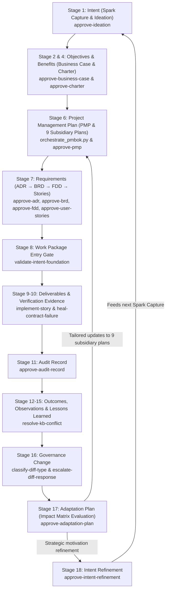

# SIDPA Template

**Synthetic Intent-Driven Process Architecture (SIDPA)**

A reusable, production-grade scaffold for the closed-loop governance-and-build methodology developed across `agent-learning`, `ADPA`, and `SocialEngage`. SIDPA establishes a formal, verifiable trace from strategic motivation through delivery, quality auditing, governance evolution, behavioral adaptation, and refined intent:

$$\text{Spark} \longrightarrow \text{Ideation} \longrightarrow \text{Business Case} \longrightarrow \text{Benefits Statement} \longrightarrow \text{Charter} \longrightarrow \text{Subsidiary Plans \& PMP} \longrightarrow \text{ADR} \longrightarrow \text{BRD} \longrightarrow \text{FDD} \longrightarrow \text{Story} \longrightarrow \text{Execution} \longrightarrow \dots$$

Every artifact-producing stage is gated by real, Bayesian `agent_learning` TaskPolicies operating under `DecisionAuthority.FULL` and multi-criteria `DecisionFrame` structures.

> **Honest Evidence Baseline:** This repository contains no project-specific application logic. It is an operational scaffold. Every TaskPolicy in `data/agent-learning/store/` is initialized but genuinely idle (zero episodes, baseline logits at 0.0). No evidence is pre-fabricated.

---

## What's Here

### 1. PMBOK 8 Planning Engine & Python Subsystem (`pmbok/`)
A complete, modular Python system enforcing PMBOK 8 and BABOK standards:
- **`pmbok/agents/`** — Autonomous `ProcessAgent` implementations and `ProcessAgentFactory` dynamically creating agents for all PMBOK 8 processes.
- **`pmbok/engines/`** — `IdeationEngine` and `BusinessCaseGenerator` with strict JSON schema validation.
- **`pmbok/audit/`** — Multi-layer governance audit subsystem: policy loader, quality control, audit scoring, regex regression testing, and prompt optimizer.
- **`pmbok/storage/`** — Relational SQLite and file-backed persistence for runtime state, artifacts, and audit registers (`StateStore`, `ArtifactStore`, `AuditStore`).
- **`pmbok/llm/`** — `FoundryClient` LLM integration with schema validation and retry mechanics.
- **`pmbok/cli/` & `pmbok/api/`** — Dual interface providing both a CLI (`pmbok/cli/main.py`) and a FastAPI REST service (`pmbok/api/app.py`).

### 2. Automation & Orchestration Scripts (`scripts/`)
Turnkey CLI tools automating setup and planning:
- **`scripts/init_project.py`** — Initializes a new project from the template, renaming `template-governance` to `<name>-governance` in active policies while keeping `agent-learning-governance` intact, instantiating `.template.md` documents, and scaffolding the Scope, Schedule, Resource, and Cost foundation packs.
- **`scripts/init_management_plan_foundations.py`** — Creates missing foundation-pack manifests and artifacts in an existing project without overwriting project-authored files. Supports selecting packs and a target project root.
- **`scripts/orchestrate_pmbok.py`** — Automates subsidiary plan generation and PMP synthesis:
  - **Full Planning (`--mode full`)**: Ingests `Project-Charter.md`, generates all 9 subsidiary management plans, and integrates them into `Project-Management-Plan.md`.
  - **Closed-Loop Adaptation (`--mode adapt`)**: Parses checked items in `Adaptation-Plan.md` (Stage 17) and selectively regenerates only the impacted subsidiary management plans.
  - **Deterministic Rollback (`--mode rollback`)**: Restores prior baselines from history archives in the event of downstream operational regression.
  - **Offline Mode (`--mock`)**: Supports deterministic local execution without external API keys.

### 3. Integrated Project Management Plan & Subsidiary Plans (`docs/project-docs/`)
Structured templates and synthesized markdown documents mapping all 9 PMBOK knowledge areas:
- `docs/project-docs/Project-Management-Plan.md` (and `.template.md`) — Stage 6 integrated PMP.
- `docs/project-docs/management-plans/` — Individual subsidiary plans:
  - `Scope-Management-Plan.md` (PMBOK 5.1)
  - `Schedule-Management-Plan.md` (PMBOK 6.1)
  - `Cost-Management-Plan.md` (PMBOK 7.1)
  - `Quality-Management-Plan.md` (PMBOK 8.1)
  - `Resource-Management-Plan.md` (PMBOK 9.1)
  - `Communications-Management-Plan.md` (PMBOK 10.1)
  - `Risk-Management-Plan.md` (PMBOK 11.1)
  - `Procurement-Management-Plan.md` (PMBOK 12.1)
  - `Stakeholder-Engagement-Plan.md` (PMBOK 13.2)
- `docs/project-docs/management-plans/history/` — Immutable SemVer baseline archive (`PMP-BL-v1.0.0`, etc.).

### 4. Document Templates with PMBOK 8 IPO Annotations (`docs/`)
All document templates are annotated with PMBOK 8 Process Groups, process numbers, and Inputs/Process/Outputs (IPO) specifications:
- `Spark-Capture.template.md` (Stage 1: Intent)
- `Ideation-Document.template.md` (Stage 1: Intent & Stage 3: Hypotheses)
- `Business-Case.template.md` & `Benefits-Statement.template.md` (Stage 4: Benefit)
- `Project-Charter.template.md` (Stage 2: Objective — PMBOK 4.1)
- `Adaptation-Plan.template.md` (Stage 17: Adaptation — PMBOK 4.6 Tailoring)
- `Intent-Refinement-Proposal.template.md` (Stage 18: Refinement — PMBOK 4.7 Closing)
- `07-architecture/ADR-TEMPLATE.md` (Stage 7: Requirement / Architecture — PMBOK 5.3)
- `project-docs/Business-Requirements/BRD-TEMPLATE.md` (Stage 7: Requirement — PMBOK 5.2)
- `project-docs/Functional-Design/FDD-TEMPLATE.md` (Stage 7: Requirement — PMBOK 5.3)
- `user-stories/EPIC-TEMPLATE.md` (Stage 7: Work Breakdown — PMBOK 5.4)
- `registers/Audit-Register.template.md` (Stage 11: Audit Record — PMBOK 8.2)
- `registers/Story-Execution-Register.template.md` (Stage 9: Deliverable Tracking — PMBOK 4.3)

### 5. Agent Skills (`.claude/skills/`)
Specialized skills driving the automated lifecycle:
- **`pmbok-planning`** — Subsidiary management plan orchestration, PMP synthesis, adaptation re-orchestration, and baseline rollback.
- **`governance`** — Bayesian TaskPolicy decision validation and policy management.
- **`implement-story`** — Contract-first TDD implementation workflow.
- **`heal-contract-failure`** — Autonomous repair loop for broken contracts and failing test suites.

### 6. Bayesian Governance Policies (`data/agent-learning/store/` & `docs/policy-shapes/`)
Canonical action specifications, decision frames, and idle policy stores:
- `docs/policy-shapes/` — Action definitions for all 15+ governance policies (`approve-ideation`, `approve-charter`, `approve-business-case`, `approve-pmp`, `approve-adr`, `approve-brd`, `approve-fdd`, `approve-user-stories`, `validate-intent-foundation`, `approve-audit-record`, `classify-diff-type`, `escalate-diff-response`, `approve-adaptation-plan`, `approve-intent-refinement`).
- `docs/policy-shapes/decision-frames/` — Multi-criteria Bayesian decision frames (e.g. `pmp-approval.json`).
- `data/agent-learning/store/` — Pre-initialized, idle policy instances.

### 7. Governance Principles & Empirical Lessons
- **`docs/chain-coverage.md`** — Comprehensive mapping of the 18-stage closed-loop lifecycle, process mappings, and directory layouts.
- **`docs/sequence-and-lessons.md`** — The battle-tested ordering rules, cited against the real projects (ADPA, SocialEngage) that surfaced them.
- **`docs/root-cause-log.md`** — Explanations for why each policy was built and where real projects diverged.

---

## Core Governance Invariants & Baseline Versioning Rules

The template enforces 5 fundamental governance invariants across the lifecycle:

1. **PMP Precedes Technical Specifications:** No ADR, BRD, FDD, or User Story may be considered baseline-approved without an active, approved `Project-Management-Plan.md` in place.
2. **Governance Change Impact Matrix:** Every Adaptation Plan must formally evaluate accepted Stage 16 amendments across all 9 subsidiary management plans using a structured Impact Matrix before selective re-orchestration.
3. **PMP Baseline Versioning & History Archival:** Every approved PMP receives an immutable SemVer identifier (`PMP-BL-v1.0.0`, `PMP-BL-v1.1.0`). Prior baselines are atomically archived to `docs/project-docs/management-plans/history/{baseline_id}/`.
4. **Baseline Traceability Invariant (Invariant 6):** Every approved PMP, ADR, BRD, FDD, User Story, and Adaptation Plan must record its governing PMP baseline identifier (`pmp_baseline: "PMP-BL-vX.Y.Z"`).
5. **Deterministic Rollback Protocol (Invariant 7):** If downstream execution reveals regressions or operational failure (detected via ADR-005 `compare_decision_results()`), atomic rollback restores the prior approved baseline from archive and penalizes the escalation bandit.

---

## The 18-Stage Closed-Loop Lifecycle



### Complete Stage-to-Policy Mapping

| # | Chain Stage | PMBOK 8 Process Group & Name | Governed Document Artifact | Assigned TaskPolicy | Decision Authority |
|---|---|---|---|---|---|
| 1 | **Intent** | Initiating: Strategic Need Identification | `Spark-Capture.md`, `Ideation-Document.md` | `approve-ideation` | `FULL` (approve, reject, request revision) |
| 2 | **Objective** | Initiating: 4.1 Develop Project Charter | `Project-Charter.md` | `approve-charter` | `FULL` (approve, reject, request revision) |
| 3 | **Hypothesis** | Initiating: Design Assumption Formulation | `Ideation-Document.md` (`HYP-*.md`) | `classify-hypothesis-status` | `FULL` (advance, validate, invalidate) |
| 4 | **Benefit** | Initiating: Benefits Realization Planning | `Business-Case.md`, `Benefits-Statement.md` | `approve-business-case` | `FULL` (approve, reject, request revision) |
| 5 | **Capability** | Executing: Capability Crystallization | Capability Matrix / Catalog | *Automated Synthesis* | Deterministic Mapping |
| 6 | **Project** | Planning: 4.2 Develop Project Management Plan | `Project-Management-Plan.md` & 9 Subsidiary Plans | `approve-pmp` | `FULL` (approve, reject, request revision) |
| 7 | **Requirement** | Planning: 5.2 Requirements & 5.3 Scope | `ADR-*.md`, `BRD-*.md`, `FDD-*.md`, `user-stories/*.md` | `approve-adr`, `approve-brd`, `approve-fdd`, `approve-user-stories` | `FULL` (approve, reject, request revision) |
| 8 | **Work Package** | Planning $\rightarrow$ Executing: 5.4 Create WBS & Gate | Epic / Sprint Backlog Entry | `validate-intent-foundation` | `FULL` (accept, reject, flag) |
| 9 | **Deliverable** | Executing: 4.3 Direct & Manage Work | Source Code & Release Artifacts | `implement-story`, `heal-contract-failure` | Direct Execution & Review |
| 10 | **Verification Evidence**| Monitoring & Controlling: 8.3 Control Quality | Contract Tests & Execution Logs | Executable Test Suite | Input Evidence (`pytest`) |
| 11 | **Audit Record** | Monitoring & Controlling: 8.2 Manage Audits | `Audit-Register.md`, `Audit-Finding.md` | `approve-audit-record` | `FULL` (approve, reject, request revision) |
| 12 | **Actual Outcome** | Monitoring & Controlling: 5.5 Validate Scope | Post-Delivery Impact Assessment | *Empirical Observation* | Baseline Comparison |
| 13 | **Observation** | Monitoring & Controlling: 4.5 Monitor & Control | Telemetry & Environment Logs | Knowledge Base Captures | Raw Input |
| 14 | **Insight** | Monitoring & Controlling: 4.4 Manage Knowledge | Synthesized Technical Findings | `resolve-kb-conflict` | `FULL` (trust existing, supersede, flag) |
| 15 | **Lesson Learned** | Monitoring & Controlling: 4.4 Lessons Learned | Formalized Organizational Knowledge | `resolve-kb-conflict` | `FULL` (trust existing, supersede, flag) |
| 16 | **Governance Change** | Monitoring & Controlling: 4.6 Integrated Change | Governance Amendments & Diffs | `classify-diff-type` & `escalate-diff-response` | Paired Pipeline (`FULL` & `LOW`) |
| 17 | **Adaptation** | Closing / Adaptive Feedback: 4.6 Tailoring | `Adaptation-Plan.md` | `approve-adaptation-plan` | `FULL` (approve, reject, request revision) |
| 18 | **Intent Refinement** | Closing: 4.7 Close Phase & Strategic Feedback | `Intent-Refinement-Proposal.md` | `approve-intent-refinement` | `FULL` (approve, reject, request revision) |

---

## Using This Scaffold for a New Project

## Using This Scaffold for a New Project

You can instantiate SIDPA for a new project in one of two ways:
- **Approach A (Recommended): GitHub Template / Repo Clone / Fork** — Best when starting a new repository from scratch.
- **Approach B: Scaffold Copy** — Best when embedding SIDPA governance into an already existing codebase.

---

### Step 1: Initialize Workspace & Configure Governance Identity

#### Approach A: Template Repository / Clone / Fork (Recommended)
1. Use GitHub's **"Use this template"** button to create a new repository, or clone / fork the repo:
   ```powershell
   gh repo create my-awesome-project --template <org>/sidpa-template --clone
   # or: git clone git@github.com:<org>/sidpa-template.git my-awesome-project
   ```
2. Run the automated initialization script to rename the governance agent ID and instantiate initial documents:
   ```powershell
   python scripts/init_project.py --name my-awesome-project
   ```
   *This automatically updates `data/agent-learning/store/` to `<my-project>-governance` (leaving `agent-learning-governance` intact), instantiates all `*.template.md` documents, and creates the four pending foundation-pack folder trees.*

#### Approach B: Embedding into an Existing Codebase (Scaffold Copy)
If you are adding SIDPA into an established repository:
1. Copy `pmbok/`, `scripts/`, and `.claude/skills/` into your existing project root.
2. Copy `data/agent-learning/store/` into your project's store.
3. Copy `docs/project-docs/`, `docs/07-architecture/`, `docs/registers/`, and `docs/user-stories/` into `docs/`.
4. Run `python scripts/init_project.py --name <your-project-name>` to configure governance IDs and instantiate `.md` document files.

To add only the management-plan foundation structure to an existing project without replacing existing files:

```powershell
python scripts/init_management_plan_foundations.py --target-root <project-root> --project-name <project-name>
```

The generated packs are pending templates, not approved baselines. Follow each manifest's prerequisites, review sequence, and separate plan-approval gate before marking artifacts approved or recording hashes.

---

### Step 2: Establish the Initiating Baseline
1. Author `docs/project-docs/Spark-Capture.md` and `docs/project-docs/Ideation-Document.md`.
2. Formulate and validate design hypotheses. Run `classify-hypothesis-status`.
3. Author `Business-Case.md` and `Benefits-Statement.md`. Run `approve-business-case`.
4. Author `Project-Charter.md`. Run `approve-charter`.

### Step 3: Orchestrate PMBOK 8 Subsidiary Plans and PMP
Use the initialized Stage 6 foundation packs before synthesizing the PMP. Draft and review Scope first; Schedule requires a Scope baseline and credible duration evidence; Resource requires Scope and Schedule baselines; Cost additionally requires the Resource/Procurement evidence stated in the Charter. The manifests define the review, roll-up, and separate plan-approval gates. Do not create schedule or cost placeholders that imply evidence or approval where prerequisites are missing.

After required inputs and foundation reviews are ready, synthesize the subsidiary plans and baseline `Project-Management-Plan.md`:
```powershell
python scripts/orchestrate_pmbok.py --mode full --charter docs/project-docs/Project-Charter.md
```
*(Add `--mock` if executing offline without live LLM foundry credentials).*

Validate the synthesized PMP through the Bayesian decision gate:
```powershell
agent-learn task-policy-decide --agent-id template-governance --task-id approve-pmp
```
Record the resulting baseline identifier (e.g. `pmp_baseline: "PMP-BL-v1.0.0"`) across all subsequent technical specifications.

### Step 4: Technical Specifications & Foundation Gate
1. Follow the strict authoring sequence: **ADR $\rightarrow$ BRD $\rightarrow$ FDD $\rightarrow$ User Story**.
2. Run respective Bayesian gates (`approve-adr`, `approve-brd`, `approve-fdd`, `approve-user-stories`).
3. Gate implementation entry with `validate-intent-foundation` before invoking `implement-story`.

### Step 5: Implementation, Testing & Auditing
1. Execute stories using the contract-first build loop (`implement-story`).
2. Run test verification (`pytest`). Resolve regressions with `heal-contract-failure`.
3. Record architectural conformance findings in `Audit-Register.md` and approve via `approve-audit-record`.

### Step 6: Closed-Loop Governance Change & Adaptation
When an operational delta, audit finding, or lessons-learned insight necessitates governance updates:
1. Pass the proposed diff through the paired governance pipeline (`classify-diff-type` $\rightarrow$ `escalate-diff-response`).
2. Draft `docs/project-docs/Adaptation-Plan.md` and evaluate the change across all 9 subsidiary management plans using the **Governance Change Impact Matrix**.
3. Approve the adaptation plan via `approve-adaptation-plan`.
4. Trigger selective re-orchestration of only the impacted subsidiary plans:
   ```powershell
   python scripts/orchestrate_pmbok.py --mode adapt --adaptation-plan docs/project-docs/Adaptation-Plan.md
   ```
5. If changes warrant strategic realignment, submit `docs/project-docs/Intent-Refinement-Proposal.md` via `approve-intent-refinement`, closing the loop back to Stage 1 Spark Capture.

---

## Running Verification Tests

The template includes an extensive automated test suite covering all modules of the PMBOK 8 planning engine, process agents, audit subsystem, storage layers, and approval gates:

```powershell
pytest
```
To run targeted unit tests:
```powershell
pytest tests/test_models.py
pytest tests/test_orchestrator.py
pytest tests/test_audit_system.py
```

---

## What This Deliberately Does (and Does Not) Do

- **Full In-Project Closed Loop:** Unlike early drafts where Adaptation and Intent Refinement were open ends, the lifecycle is now fully closed from Spark through Adaptation and Refinement.
- **Cross-Project Knowledge Sharing:** Observation $\rightarrow$ Insight $\rightarrow$ Lesson Learned synthesis (Stages 13–15) connects to an external, shared knowledge base (`obsidian-brain-ingestor` / `resolve-kb-conflict`) rather than inventing a duplicate per-project silo.
- **Zero Fabricated Evidence:** TaskPolicies are declared with exact Bayesian shapes and multi-criteria decision frames, but they remain strictly uncalibrated until actual project decisions are registered.
- **Living Template:** When a project uncovers a recurring decision pattern requiring a new TaskPolicy, document the trigger in `docs/root-cause-log.md` in the template so future projects benefit from the discovery.
