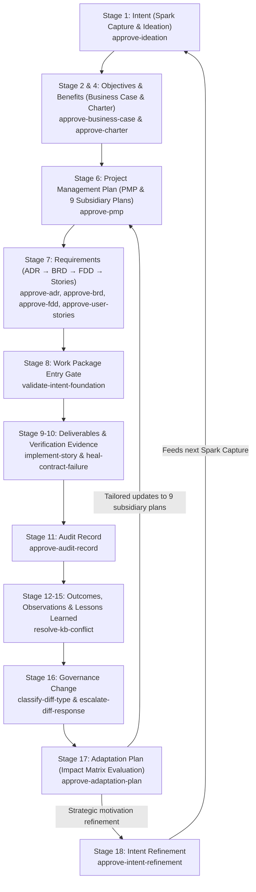

# SIDPA Template

**Synthetic Intent-Driven Process Architecture (SIDPA)**

A reusable, production-grade scaffold for the closed-loop governance-and-build methodology developed across `agent-learning`, `ADPA`, and `SocialEngage`. SIDPA establishes a formal, verifiable trace from strategic motivation through delivery, quality auditing, governance evolution, behavioral adaptation, and refined intent:

$$\text{Spark} \longrightarrow \text{Ideation} \longrightarrow \text{Business Case} \longrightarrow \text{Benefits Statement} \longrightarrow \text{Charter} \longrightarrow \text{Subsidiary Plans \& PMP} \longrightarrow \text{ADR} \longrightarrow \text{BRD} \longrightarrow \text{FDD} \longrightarrow \text{Story} \longrightarrow \text{Execution} \longrightarrow \dots$$

Every artifact-producing stage is gated by real, Bayesian `agent_learning` TaskPolicies operating under `DecisionAuthority.FULL` and multi-criteria `DecisionFrame` structures.

> **Honest Evidence Baseline:** This repository contains no project-specific application logic. It is an operational scaffold. Every TaskPolicy in `data/agent-learning/store/` is initialized but genuinely idle (zero episodes, baseline logits at 0.0). No evidence is pre-fabricated.

---

## What's Here

### 1. Plan standards and skeletons (`docs/project-docs/management-plans/`)
Nine subsidiary-plan skeletons (`*.template.md`), one per PMBOK 8 plan, each carrying the same content contract: frontmatter (`plan_id`, domains, `route`, `generator`, `baseline_id`, `cycle_id`, `owner_role`, `depends_on`, `inputs`, `outputs`, `governance_policy`), three literal headings (`## 1. Intent, Alignment & Boundaries`, `## 2. Domain Mechanics & Standards`, `## 3. Governance, Control & Decision Rights`), an out-of-scope rule, and word-count floors and caps that are flags, not blocks. The standards come from `agent-learning` ADR-012 and ADR-025 to ADR-033. Scope, Schedule and Cost are Tier 1 (baseline-substantiating); Risk and Quality are Tier 2; Resource, Stakeholder Engagement, Communications and Procurement are Tier 3. Dependencies form a graph rooted at Scope.

### 2. Scripts (`scripts/`)
- **`scripts/init_project.py`**: renames `template-governance` to `<name>-governance` in the policy store (keeping `agent-learning-governance` intact), then copies the skeletons for the chosen stage to working `.md` files without overwriting anything, filling the project name and start date. Stages: `start` (Spark through Charter and the registers), `plans`, `closing`, `all`.

This template stores only template values. The earlier SQLite/FastAPI planning engine and `orchestrate_pmbok.py` were removed, following `agent-learning` ADR-034. Plans are drafted from the skeletons (see `.claude/skills/pmbok-planning/SKILL.md`) until a small pure-Python module replaces the old engine.

### 3. Integrated Project Management Plan (`docs/project-docs/`)
`Project-Management-Plan.template.md` is the Stage 6 integration skeleton. It is created in the `plans` stage and synthesized from the approved plans. Approved baselines are archived to `docs/project-docs/management-plans/history/<baseline_id>/`.

### 4. Document Templates with PMBOK 8 IPO Annotations (`docs/`)
All document templates are annotated with PMBOK 8 Process Groups, process numbers, and Inputs/Process/Outputs (IPO) specifications:
- `Spark-Capture.template.md` (Stage 1: Intent)
- `Ideation-Document.template.md` (Stage 1: Intent & Stage 3: Hypotheses)
- `Business-Case.template.md` & `Benefits-Statement.template.md` (Stage 4: Benefit)
- `Project-Charter.template.md` (Stage 2: Objective — PMBOK 4.1)
- `Adaptation-Plan.template.md` (Stage 17: Adaptation — PMBOK 4.6 Tailoring)
- `Intent-Refinement-Proposal.template.md` (Stage 18: Refinement — PMBOK 4.7 Closing)
- `07-architecture/ADR-TEMPLATE.md` (Stage 7: Requirement / Architecture — PMBOK 5.3)
- `project-docs/Business-Requirements/BRD-TEMPLATE.md` (Stage 7: Requirement — PMBOK 5.2)
- `project-docs/Functional-Design/FDD-TEMPLATE.md` (Stage 7: Requirement — PMBOK 5.3)
- `user-stories/EPIC-TEMPLATE.md` (Stage 7: Work Breakdown — PMBOK 5.4)
- `registers/Audit-Register.template.md` (Stage 11: Audit Record — PMBOK 8.2)
- `registers/Story-Execution-Register.template.md` (Stage 9: Deliverable Tracking — PMBOK 4.3)

### 5. Agent Skills (`.claude/skills/`)
Specialized skills driving the automated lifecycle:
- **`pmbok-planning`** — Drafting the nine plans from their skeletons, the per-plan approval gate, PMP formalization, cycles, staleness, adaptation and rollback.
- **`governance`** — Bayesian TaskPolicy decision validation and policy management.
- **`implement-story`** — Contract-first TDD implementation workflow.
- **`heal-contract-failure`** — Autonomous repair loop for broken contracts and failing test suites.

### 6. Bayesian Governance Policies (`data/agent-learning/store/` & `docs/policy-shapes/`)
Canonical action specifications, decision frames, and idle policy stores:
- `docs/policy-shapes/` — Action definitions for all 15+ governance policies (`approve-ideation`, `approve-charter`, `approve-business-case`, `approve-pmp`, `approve-adr`, `approve-brd`, `approve-fdd`, `approve-user-stories`, `validate-intent-foundation`, `approve-audit-record`, `classify-diff-type`, `escalate-diff-response`, `approve-adaptation-plan`, `approve-intent-refinement`).
- `docs/policy-shapes/decision-frames/` — A frame template (`approve-adr.frame.template.json`) and a README. Real frames belong to the project, not the template.
- `data/agent-learning/store/` — Pre-initialized, idle policy instances.

### 7. Governance Principles & Empirical Lessons
- **`docs/chain-coverage.md`** — Comprehensive mapping of the 18-stage closed-loop lifecycle, process mappings, and directory layouts.
- **`docs/sequence-and-lessons.md`** — The battle-tested ordering rules, cited against the real projects (ADPA, SocialEngage) that surfaced them.
- **`docs/root-cause-log.md`** — Explanations for why each policy was built and where real projects diverged.

---

### 8. Learning Methodologies (`docs/methodologies/`)
- **`catalog.json`** — the 32 learning methodologies, each with a state, an example class (`runnable`, `proof_of_concept`, `documented`) and the ADR or hypothesis where they exist.
- **`Tailoring-Matrix.md`** — candidate pairings of a need in the store or in lessons learned with a methodology. Every row is a hypothesis.
- **`docs/registers/Methodology-Best-Practice-Ledger.template.md`** — the append-only ledger of practices. A practice is adopted only on real episodes that meet the tier gate; the template ships no entries. `init_project.py --stage start` scaffolds it.
- **`docs/methodologies/README.md`** — the layout and the labeling contract for any example (synthetic, not evidence).

## Core Governance Invariants & Baseline Versioning Rules

The template enforces 5 fundamental governance invariants across the lifecycle:

1. **PMP Precedes Technical Specifications:** No ADR, BRD, FDD, or User Story may be considered baseline-approved without an active, approved `Project-Management-Plan.md` in place.
2. **Governance Change Impact Matrix:** Every Adaptation Plan must formally evaluate accepted Stage 16 amendments across all 9 subsidiary management plans using a structured Impact Matrix before selective re-orchestration.
3. **PMP Baseline Versioning & History Archival:** Every approved PMP receives an immutable SemVer identifier (`PMP-BL-v1.0.0`, `PMP-BL-v1.1.0`). Prior baselines are atomically archived to `docs/project-docs/management-plans/history/{baseline_id}/`.
4. **Baseline Traceability Invariant (Invariant 6):** Every approved PMP, ADR, BRD, FDD, User Story, and Adaptation Plan must record its governing PMP baseline identifier (`baseline_id: "PMP-BL-vX.Y.Z"` and `cycle_id: "CYC-NNN"`).
5. **Deterministic Rollback Protocol (Invariant 7):** If downstream execution reveals regressions or operational failure (detected via ADR-005 `compare_decision_results()`), atomic rollback restores the prior approved baseline from archive and penalizes the escalation bandit.

---

## The 18-Stage Closed-Loop Lifecycle



### Complete Stage-to-Policy Mapping

| # | Chain Stage | PMBOK 8 Process Group & Name | Governed Document Artifact | Assigned TaskPolicy | Decision Authority |
|---|---|---|---|---|---|
| 1 | **Intent** | Initiating: Strategic Need Identification | `Spark-Capture.md`, `Ideation-Document.md` | `approve-ideation` | `FULL` (approve, reject, request revision) |
| 2 | **Objective** | Initiating: 4.1 Develop Project Charter | `Project-Charter.md` | `approve-charter` | `FULL` (approve, reject, request revision) |
| 3 | **Hypothesis** | Initiating: Design Assumption Formulation | `Ideation-Document.md` (`HYP-*.md`) | `classify-hypothesis-status` | `FULL` (advance, validate, invalidate) |
| 4 | **Benefit** | Initiating: Benefits Realization Planning | `Business-Case.md`, `Benefits-Statement.md` | `approve-business-case` | `FULL` (approve, reject, request revision) |
| 5 | **Capability** | Executing: Capability Crystallization | Capability Matrix / Catalog | *Automated Synthesis* | Deterministic Mapping |
| 6 | **Project** | Planning: 4.2 Develop Project Management Plan | `Project-Management-Plan.md` & 9 Subsidiary Plans | `approve-pmp` | `FULL` (approve, reject, request revision) |
| 7 | **Requirement** | Planning: 5.2 Requirements & 5.3 Scope | `ADR-*.md`, `BRD-*.md`, `FDD-*.md`, `user-stories/*.md` | `approve-adr`, `approve-brd`, `approve-fdd`, `approve-user-stories` | `FULL` (approve, reject, request revision) |
| 8 | **Work Package** | Planning $\rightarrow$ Executing: 5.4 Create WBS & Gate | Epic / Sprint Backlog Entry | `validate-intent-foundation` | `FULL` (accept, reject, flag) |
| 9 | **Deliverable** | Executing: 4.3 Direct & Manage Work | Source Code & Release Artifacts | `implement-story`, `heal-contract-failure` | Direct Execution & Review |
| 10 | **Verification Evidence**| Monitoring & Controlling: 8.3 Control Quality | Contract Tests & Execution Logs | Executable Test Suite | Input Evidence (`pytest`) |
| 11 | **Audit Record** | Monitoring & Controlling: 8.2 Manage Audits | `Audit-Register.md`, `Audit-Finding.md` | `approve-audit-record` | `FULL` (approve, reject, request revision) |
| 12 | **Actual Outcome** | Monitoring & Controlling: 5.5 Validate Scope | Post-Delivery Impact Assessment | *Empirical Observation* | Baseline Comparison |
| 13 | **Observation** | Monitoring & Controlling: 4.5 Monitor & Control | Telemetry & Environment Logs | Knowledge Base Captures | Raw Input |
| 14 | **Insight** | Monitoring & Controlling: 4.4 Manage Knowledge | Synthesized Technical Findings | `resolve-kb-conflict` | `FULL` (trust existing, supersede, flag) |
| 15 | **Lesson Learned** | Monitoring & Controlling: 4.4 Lessons Learned | Formalized Organizational Knowledge | `resolve-kb-conflict` | `FULL` (trust existing, supersede, flag) |
| 16 | **Governance Change** | Monitoring & Controlling: 4.6 Integrated Change | Governance Amendments & Diffs | `classify-diff-type` & `escalate-diff-response` | Paired Pipeline (`FULL` & `LOW`) |
| 17 | **Adaptation** | Closing / Adaptive Feedback: 4.6 Tailoring | `Adaptation-Plan.md` | `approve-adaptation-plan` | `FULL` (approve, reject, request revision) |
| 18 | **Intent Refinement** | Closing: 4.7 Close Phase & Strategic Feedback | `Intent-Refinement-Proposal.md` | `approve-intent-refinement` | `FULL` (approve, reject, request revision) |

---

## Using This Scaffold for a New Project

You can instantiate SIDPA for a new project in one of two ways:
- **Approach A (Recommended): GitHub Template / Repo Clone / Fork** — Best when starting a new repository from scratch.
- **Approach B: Scaffold Copy** — Best when embedding SIDPA governance into an already existing codebase.

---

### Step 1: Initialize Workspace & Configure Governance Identity

#### Approach A: Template Repository / Clone / Fork (Recommended)
1. Use GitHub's **"Use this template"** button to create a new repository, or clone / fork the repo:
   ```powershell
   gh repo create my-awesome-project --template <org>/sidpa-template --clone
   # or: git clone git@github.com:<org>/sidpa-template.git my-awesome-project
   ```
2. Run the automated initialization script to rename the governance agent ID and instantiate initial documents:
   ```powershell
   python scripts/init_project.py --name my-awesome-project
   ```
   *This renames the governance agent in `data/agent-learning/store/` to `<my-project>-governance` (leaving `agent-learning-governance` intact), creates the Spark-to-Charter documents and the registers, and opens `CYC-001` in `docs/registers/Cycle-Register.md`. Plan skeletons are created later with `--stage plans`.*

#### Approach B: Embedding into an Existing Codebase (Scaffold Copy)
If you are adding SIDPA into an established repository:
1. Copy `scripts/` and `.claude/skills/` into your existing project root.
2. Copy `data/agent-learning/store/` into your project's store.
3. Copy `docs/project-docs/`, `docs/07-architecture/`, `docs/registers/`, and `docs/user-stories/` into `docs/`.
4. Run `python scripts/init_project.py --name <your-project-name>` to configure governance IDs and instantiate `.md` document files.

---

### Step 2: Establish the Initiating Baseline
1. Author `docs/project-docs/Spark-Capture.md` and `docs/project-docs/Ideation-Document.md`.
2. Formulate and validate design hypotheses. Run `classify-hypothesis-status`.
3. Author `Business-Case.md` and `Benefits-Statement.md`. Run `approve-business-case`.
4. Author `Project-Charter.md`. Run `approve-charter`.

### Step 3: Draft the Subsidiary Plans and the PMP
Create the skeletons once the Charter is approved:
```powershell
python scripts/init_project.py --name my-awesome-project --stage plans
```
Draft the plans in dependency order (Scope first), approve each `full_plan` through `approve-subsidiary-plan`, then synthesize the Project Management Plan and run the PMP gate:
```powershell
agent-learn task-policy-decide --agent-id my-awesome-project-governance --task-id approve-pmp --decision-frame <frame>
```
Record the resulting baseline identifier (for example `baseline_id: "PMP-BL-v1.0.0"`) and close or continue the cycle in `docs/registers/Cycle-Register.md`. See `.claude/skills/pmbok-planning/SKILL.md`.

### Step 4: Technical Specifications & Foundation Gate
1. Follow the strict authoring sequence: **ADR $\rightarrow$ BRD $\rightarrow$ FDD $\rightarrow$ User Story**.
2. Run respective Bayesian gates (`approve-adr`, `approve-brd`, `approve-fdd`, `approve-user-stories`).
3. Gate implementation entry with `validate-intent-foundation` before invoking `implement-story`.

### Step 5: Implementation, Testing & Auditing
1. Execute stories using the contract-first build loop (`implement-story`).
2. Run test verification (`pytest`). Resolve regressions with `heal-contract-failure`.
3. Record architectural conformance findings in `Audit-Register.md` and approve via `approve-audit-record`.

### Step 6: Closed-Loop Governance Change & Adaptation
When an operational delta, audit finding, or lessons-learned insight necessitates governance updates:
1. Pass the proposed diff through the paired governance pipeline (`classify-diff-type` $\rightarrow$ `escalate-diff-response`).
2. Draft `docs/project-docs/Adaptation-Plan.md` and evaluate the change across all 9 subsidiary management plans using the **Governance Change Impact Matrix**.
3. Approve the adaptation plan via `approve-adaptation-plan`.
4. Open a new cycle in the Cycle Register, revise only the impacted subsidiary plans, re-approve them and anything stale, then run `approve-pmp`.
5. If changes warrant strategic realignment, submit `docs/project-docs/Intent-Refinement-Proposal.md` via `approve-intent-refinement`, closing the loop back to Stage 1 Spark Capture.

---

## Running Verification Tests

The template's own tests check that the plan skeletons follow the content contract, that their dependency graph is acyclic and rooted at Scope, that no project-specific artifacts are stored, and that `scripts/init_project.py` scaffolds a working project:

```powershell
python -m pytest tests
```

---

## What This Deliberately Does (and Does Not) Do

- **Full In-Project Closed Loop:** Unlike early drafts where Adaptation and Intent Refinement were open ends, the lifecycle is now fully closed from Spark through Adaptation and Refinement.
- **Cross-Project Knowledge Sharing:** Observation $\rightarrow$ Insight $\rightarrow$ Lesson Learned synthesis (Stages 13–15) connects to an external, shared knowledge base (`obsidian-brain-ingestor` / `resolve-kb-conflict`) rather than inventing a duplicate per-project silo.
- **Zero Fabricated Evidence:** TaskPolicies are declared with exact Bayesian shapes and multi-criteria decision frames, but they remain strictly uncalibrated until actual project decisions are registered.
- **Living Template:** When a project uncovers a recurring decision pattern requiring a new TaskPolicy, document the trigger in `docs/root-cause-log.md` in the template so future projects benefit from the discovery.
