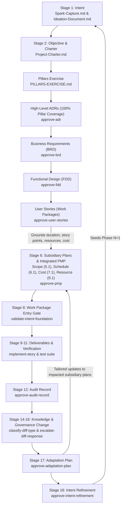

# Intent-to-Outcome Chain — PMBOK 8 Process Alignment and Closed-Loop Governance

Source of the chain concept: SocialEngage's `Intent-to-Outcome-Chain-and-TaskPolicy-Coverage.md` (Obsidian Brain wiki) and the SIDPA Project Management Lifecycle.

In enterprise software engineering and agentic governance (PMBOK 8 / SIDPA), every stage that yields a documented artifact requires a formal Bayesian validation gate. We start with a **Spark** and systematically trace intent through execution, verification, governance amendment, behavioral adaptation, and back to refined intent—closing the complete development lifecycle loop.

All document-approval policies operate under `DecisionAuthority.FULL` using multi-criteria Bayesian evaluation (`DecisionFrame`), with human adjudication mandated (`requires_human_approval: true`).

---

## 1. Document Authoring Sequence vs. Conceptual Ontology

There is an important distinction between the abstract conceptual trace and the **actual document build sequence**:

* **Conceptual Ontology (`traceabilityChain`):**
  $$\text{Intent} \longrightarrow \text{Objective} \longrightarrow \text{Hypothesis} \longrightarrow \text{Benefit} \longrightarrow \dots$$
* **Actual Document Authoring & Governance Sequence (PMBOK 8 / SIDPA Lifecycle):**
  ```
  1. Spark Capture (Intent — Initiating)
         ↓
  2. Ideation Document (Hypotheses — Initiating)
         ↓
  3. Business Case & Benefits Statement (Benefit — Initiating)
         ↓
  4. Project Charter (Objective — Initiating: 4.1 Develop Project Charter)
         ↓
  5. Pillars Exercise (Architectural Strategy Formulation: 5.3)
         ↓
  6. High-Level Foundational ADRs (100% Pillar Coverage: 5.3)
         ↓
  7. Business Requirements Document (BRD: 5.2 Collect Requirements)
         ↓
  8. Functional Design Document (FDD: 5.3 Define Scope / Design)
         ↓
  9. User Stories (Work Packages & WBS Decomposition: 5.4)
         ↓
  10. Subsidiary Management Plans (Scope 5.1, Schedule 6.1, Cost 7.1, Resource 9.1, Quality 8.1, etc.)
      & Integrated Project Management Plan (Planning: 4.2 Develop PMP)
         ↓
  11. Foundation Validation Gate (Planning → Executing Entry Gate: validate-intent-foundation)
         ↓
  12. Implementation & Verification (Executing: 4.3 & Monitoring & Controlling: 8.3)
         ↓
  13. Audit Record & Knowledge Synthesis (Monitoring & Controlling: 8.2 & 4.4)
         ↓
  14. Paired Governance Pipeline (Monitoring & Controlling: 4.6 Integrated Change Control)
         ↓
  15. Adaptation Plan (Adaptive Closing / Feedback: Tailoring PMP Updates)
         ↓
  16. Intent Refinement (Closing: 4.7 Close Phase & Strategic Feedback to Spark)
  ```

---

## 2. Complete Chain Coverage Matrix (PMBOK 8 Process Mapping)

| # | Chain Stage | PMBOK 8 Process Group | PMBOK 8 Process Number & Name | Governed Document Artifact | Assigned TaskPolicy | Authority & Decision Shape | Lifecycle Role & IPO |
|---|---|---|---|---|---|---|---|
| 1 | **Intent** | **Initiating** | Pre-Project: Strategic Need Identification | `Spark-Capture.md`<br>`Ideation-Document.md` | `template-governance` / **`approve-ideation`** | `FULL`<br>(3 actions: approve, reject, request revision) | **Starts with a Spark.** Inputs: Trigger event / strategic driver. Process: Validate intent. Output: Approved Ideation. |
| 2 | **Objective** | **Initiating** | 4.1 Develop Project Charter | `Project-Charter.md` | `template-governance` / **`approve-charter`** | `FULL`<br>(3 actions: approve, reject, request revision) | Inputs: Business Case & Benefits. Process: Authorize project & assign sponsor. Output: Project Charter. |
| 3 | **Hypothesis** | **Initiating** | Pre-Project: Design Assumption Formulation | `Ideation-Document.md`<br>(Hypothesis section / `HYP-*.md`) | `agent-learning-governance` / **`classify-hypothesis-status`** | `FULL`<br>(7 actions: advance to testing, mark validated, mark invalidated, etc.) | Inputs: Design assumptions & test logs. Process: Evaluate empirical evidence. Output: Validated / testing status. |
| 4 | **Benefit** | **Initiating** | Business Documents: Benefits Realization Planning | `Business-Case.md`<br>`Benefits-Statement.md` | `template-governance` / **`approve-business-case`** | `FULL`<br>(3 actions: approve, reject, request revision) | Inputs: Hypotheses & ROI premise. Process: Validate economics. Output: Benefits Statement (Input to Charter). |
| 5 | **Pillars & Architecture** | **Planning** | 5.3 Define Scope (Architectural Strategy) | `PILLARS-EXERCISE.md`<br>High-Level `ADR-*.md` | `template-governance` / **`approve-adr`** | `FULL`<br>(3 actions: approve, reject, request revision) | Inputs: Project Charter & Hypotheses. Process: Decompose Charter into pillars; draft ADRs providing 100% pillar coverage. Output: Approved Pillars & ADRs. |
| 6 | **Requirements & Design** | **Planning** | 5.2 Collect Requirements & 5.3 Define Scope | `BRD-*.md`<br>`FDD-*.md` | `template-governance` /<br>• **`approve-brd`**<br>• **`approve-fdd`** | `FULL`<br>(3 actions each) | Inputs: Approved ADRs. Process: Business requirements and functional design specification. Output: Approved BRD and FDD. |
| 7 | **Work Packages** | **Planning** | 5.4 Create WBS | `user-stories/*.md` (with BDD criteria) | `template-governance` / **`approve-user-stories`** | `FULL`<br>(3 actions: approve, reject, request revision) | Inputs: Approved FDDs. Process: Decompose into atomic User Stories. **Output: Work Packages feeding Schedule/Cost/Scope plans.** |
| 8 | **Integrated PMP** | **Planning** | 4.2 Develop Project Management Plan | `Project-Management-Plan.md`<br>& Subsidiary Plans (5.1–13.2) | `template-governance` / **`approve-pmp`** | `FULL`<br>(3 actions: approve, reject, request revision) | Inputs: Project Charter & User Story Work Packages. Process: Ground duration/cost/scope baselines. Output: Approved PMP (`PMP-BL-vX.Y.Z`). |
| 9 | **Pipeline Entry Gate** | **Planning → Executing** | 5.4 Create WBS & Sprint Gate | Epic / Work Package Readiness Check | `template-governance` / **`validate-intent-foundation`** | `FULL`<br>(3 actions: accept, reject, flag) | Inputs: Approved requirements and PMP baseline. Process: Gate implementation entry per instance. Output: Provisioned git worktree. |
| 10 | **Deliverable** | **Executing** | 4.3 Direct & Manage Project Work | Source Code & Release Artifacts | `implement-story` & `heal-contract-failure` | Direct Execution & Review | Inputs: Approved stories & acceptance criteria. Process: TDD / contract-first build. Output: Executable code deliverable. |
| 11 | **Verification Evidence** | **Monitoring & Controlling** | 8.3 Control Quality | Contract Tests & Execution Logs | Executable Test Suite | Input Evidence | Inputs: Code deliverable & contract tests. Process: Execute test suite. Output: Verification evidence report (pytest / vitest). |
| 12 | **Audit Record** | **Monitoring & Controlling** | 8.2 Manage Quality Audits | `Audit-Register.md`<br>`Audit-Finding.md` | `template-governance` / **`approve-audit-record`** | `FULL`<br>(3 actions: approve, reject, request revision) | Inputs: Deliverables & verification logs. Process: Audit architectural conformance. Output: Approved Audit Register entries. |
| 13 | **Actual Outcome** | **Monitoring & Controlling** | 5.5 Validate Scope & Value Realization | Post-Delivery Impact Assessment | *Empirical Observation* | Baseline Comparison | Inputs: Production telemetry & Benefits Statement. Process: Compare realized vs expected value. Output: Impact deltas. |
| 14 | **Observation** | **Monitoring & Controlling** | 4.5 Monitor & Control Project Work | Telemetry & Environment Gotchas | Knowledge Base Captures | Raw Input | Inputs: Runtime telemetry & review findings. Process: Record raw telemetry. Output: Uninterpreted observation log. |
| 15 | **Insight** | **Monitoring & Controlling** | 4.4 Manage Project Knowledge (Synthesis) | Synthesized Technical Findings | `obsidian-brain-ingestor` / **`resolve-kb-conflict`** | `FULL`<br>(trust existing, supersede, flag) | Inputs: Observation logs. Process: Synthesize causal significance. Output: Resolved insight node. |
| 16 | **Lesson Learned** | **Monitoring & Controlling** | 4.4 Manage Project Knowledge (Lessons Learned Register) | Formalized Organizational Knowledge | `obsidian-brain-ingestor` / **`resolve-kb-conflict`** | `FULL`<br>(trust existing, supersede, flag) | Inputs: Verified insights. Process: Crystallize actionable knowledge. Output: Formalized Lessons Learned register. |
| 17 | **Governance Change** | **Monitoring & Controlling** | 4.6 Perform Integrated Change Control | Governance Amendments & Diffs | `template-governance` /<br>• **`classify-diff-type`**<br>• **`escalate-diff-response`** | Paired Pipeline:<br>• `FULL` (7 diff classes)<br>• `LOW` (3 escalation actions) | Inputs: Lessons learned & proposed diffs. Process: Semantic classification & escalation bandit. Output: Governed baseline update. |
| 18 | **Adaptation & Refinement** | **Closing / Adaptive Feedback** | 4.6 Tailoring & 4.7 Close Phase | `Adaptation-Plan.md`<br>`Intent-Refinement-Proposal.md` | `template-governance` /<br>• **`approve-adaptation-plan`**<br>• **`approve-intent-refinement`** | `FULL`<br>(3 actions each) | Inputs: Validated Stage 17 governance change & realized outcomes. Process: Tailor PMP subsidiary plans & refine intent. Output: **Catalyst for Phase N+1 Spark Capture**. |

---

## 3. The Continuous Adaptation & PMP Feedback Cycle



---

## 4. Directory Layout in This Template

```
sidpa-template/
├── .github/
│   └── instructions/
│       ├── codacy.instructions.md
│       └── sidpa-governance-qa.instructions.md     # Universal QA directives for agents
├── docs/
│   ├── chain-coverage.md                         # This comprehensive coverage matrix
│   ├── sequence-and-lessons.md                   # Battle-tested sequence rules and empirical lessons
│   ├── root-cause-log.md                         # Policy justifications
│   ├── project-docs/
│   │   ├── Spark-Capture.template.md              # Stage 1: Intent (Initiating)
│   │   ├── Ideation-Document.template.md          # Stage 1: Intent & Stage 3: Hypotheses (Initiating)
│   │   ├── Project-Charter.template.md            # Stage 2: Objective (Initiating: 4.1)
│   │   ├── Business-Case.template.md              # Stage 4: Benefit (Initiating)
│   │   ├── Benefits-Statement.template.md         # Stage 4: Benefit (Initiating)
│   │   ├── Project-Management-Plan.template.md    # Stage 6: PMP & Subsidiary Plans (Planning: 4.2)
│   │   ├── Adaptation-Plan.template.md            # Stage 17: Adaptation (Monitoring & Controlling / Tailoring)
│   │   ├── Intent-Refinement-Proposal.template.md # Stage 18: Intent Refinement (Closing: 4.7)
│   │   ├── Business-Requirements/
│   │   │   └── BRD-TEMPLATE.md                    # Requirement (Planning: 5.2/5.3)
│   │   └── Functional-Design/
│   │       └── FDD-TEMPLATE.md                    # Requirement (Planning: 5.3)
│   ├── 07-architecture/
│   │   ├── PILLARS-TEMPLATE.md                    # Stage 5.5: Architectural Pillars Definition
│   │   └── ADR-TEMPLATE.md                        # Stage 5.5 / 7: Architectural Decision Records
│   ├── user-stories/
│   │   └── EPIC-TEMPLATE.md                       # Work Packages (Planning: 5.4)
│   ├── registers/
│   │   ├── Audit-Register.template.md             # Stage 12: Audit Record (PMBOK 8.2)
│   │   └── Story-Execution-Register.template.md   # Deliverable Tracking (PMBOK 4.3)
│   └── policy-shapes/                             # Canonical JSON action shape specifications
```

---

## 5. Governance Invariants & Baseline Versioning Rules

1. **PMP Precedes Technical Specifications (Invariant 1):** No ADR, BRD, FDD, or User Story may be considered baseline-approved without an active, approved `Project-Management-Plan.md` in place.
2. **Pillars Full-Coverage Invariant (Invariant 2):** High-level foundational ADRs drafted after the Pillars Exercise must provide 100% full coverage across all identified pillars before moving to detailed requirements.
3. **User Stories ARE Work Packages (Invariant 3):** User Stories derived from FDDs with BDD acceptance criteria constitute the concrete work packages that ground the Scope (5.1), Schedule (6.1), Cost (7.1), and Resource (9.1) subsidiary plans into the integrated PMP.
4. **Governance Change Impact Matrix (Invariant 4):** Every Adaptation Plan must formally evaluate accepted Stage 17 amendments across all 9 subsidiary management plans using a structured Impact Matrix before selective re-orchestration.
5. **PMP Baseline Versioning & History Archival (Invariant 5):** Every approved PMP receives an immutable SemVer identifier (`PMP-BL-v1.0.0`, `PMP-BL-v1.1.0`). Prior baselines are atomically archived to `docs/project-docs/management-plans/history/{baseline_id}/`.
6. **Baseline Traceability Invariant (Invariant 6):** Every approved PMP, ADR, BRD, FDD, User Story, and Adaptation Plan must record its governing PMP baseline identifier (`pmp_baseline: "PMP-BL-vX.Y.Z"`).
7. **Deterministic Rollback Protocol (Invariant 7):** If downstream execution reveals regressions or operational failure (detected via ADR-005 `compare_decision_results()`), atomic rollback restores the prior approved baseline from archive and penalizes the escalation bandit.
