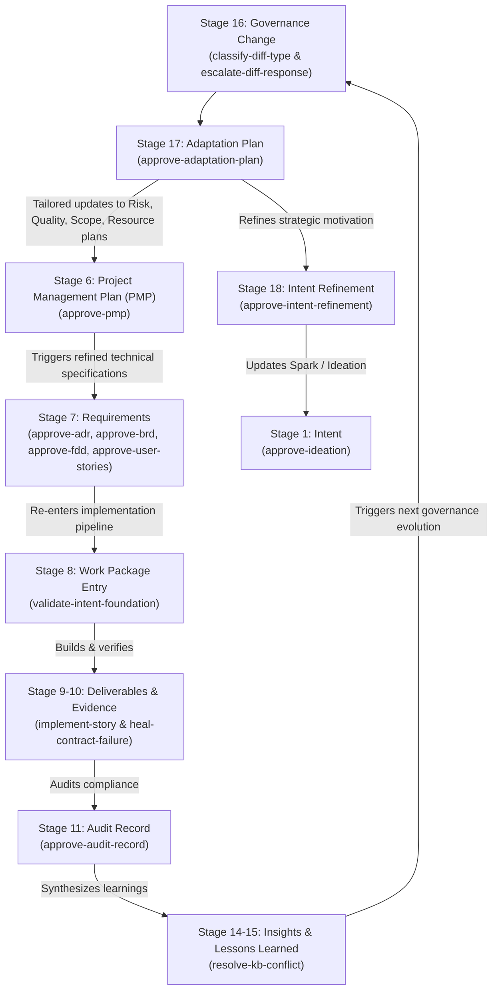

# Intent-to-Outcome Chain — Full Document Validation and Closed-Loop Governance

Source of the 18-stage chain concept: SocialEngage's `Intent-to-Outcome-Chain-and-TaskPolicy-Coverage.md` (Obsidian Brain wiki) and the SIDPA Project Management Lifecycle.

In enterprise software engineering and agentic governance (PMBOK 8 / SIDPA), every stage that yields a documented artifact requires a formal Bayesian validation gate. We start with a **Spark** and systematically trace intent through execution, verification, governance amendment, behavioral adaptation, and back to refined intent—closing the complete development lifecycle loop.

All document-approval policies operate under `DecisionAuthority.FULL` using multi-criteria Bayesian evaluation (`DecisionFrame`), with human adjudication mandated (`requires_human_approval: true`).

---

## 1. Document Authoring Sequence vs. Conceptual Ontology

There is a vital distinction between the abstract conceptual trace and the **actual document build sequence**:

* **Conceptual Ontology (`traceabilityChain`):**
  $$\text{Intent} \longrightarrow \text{Objective} \longrightarrow \text{Hypothesis} \longrightarrow \text{Benefit} \longrightarrow \dots$$
* **Actual Document Authoring & Governance Sequence (PMBOK 8 / SIDPA Lifecycle):**
  ```
  1. Spark Capture (Intent)
         ↓
  2. Ideation Document (Hypotheses)
         ↓
  3. Business Case & Benefits Statement (Benefit)
         ↓
  4. Project Charter (Objective)
         ↓
  5. Subsidiary Management Plans & Project Management Plan (PMP)
         ↓
  6. Technical Specifications: ADR → BRD → FDD → User Stories (Requirement)
         ↓
  7. Foundation Validation Gate (Work Package Entry)
         ↓
  8. Implementation & Verification (Deliverable & Evidence)
         ↓
  9. Audit Record & Knowledge Synthesis (Audit, Insight, Lesson Learned)
         ↓
  10. Paired Governance Pipeline (Governance Change)
         ↓
  11. Adaptation Plan (tailoring Management Plan updates feeding back to PMP)
         ↓
  12. Intent Refinement (closing the cognitive loop back to Spark / Intent)
  ```

### Why the Charter & PMP Sequence Matters
- **Benefits are Inputs to the Charter:** In PMBOK 8, the Business Case and Benefits Statement are mandatory *inputs* to the Project Charter. Success criteria in the Charter must be traced directly to expected benefits.
- **PMP Formalizes Subsidiary Plans before Coding:** The Project Management Plan (PMP) integrates subsidiary management plans (Scope, Risk, Quality, Resource, Communications). It is formalized **after** the Charter and **before** technical specifications (ADR/BRD/FDD/Stories) are drafted.
- **Adaptation Feeds the PMP:** When governance changes (Stage 16) occur, the Adaptation Plan (Stage 17) explicitly tailors which subsidiary management plans require updates. This updates the PMP, which cascades into refined ADRs, BRDs, FDDs, and Stories—closing the continuous development loop.

---

## 2. Complete 18-Stage Chain Coverage Matrix

| # | Chain Stage | Governed Document Artifact | Assigned TaskPolicy | Authority & Decision Shape | Lifecycle Role |
|---|---|---|---|---|---|
| 1 | **Intent** | `Spark-Capture.md`<br>`Ideation-Document.md` | `template-governance` / **`approve-ideation`** | `FULL`<br>(3 actions: approve, reject, request revision) | **Starts with a Spark.** Validates strategic motivation, grounded problem formulation, and initial scope before chartering. |
| 2 | **Objective** | `Project-Charter.md` | `template-governance` / **`approve-charter`** | `FULL`<br>(3 actions: approve, reject, request revision) | Validates charter authority, measurable objectives traced to benefits, and realistic scope without forcing premature subsidiary plans. |
| 3 | **Hypothesis** | `Ideation-Document.md`<br>(Hypothesis section / `HYP-*.md`) | `agent-learning-governance` / **`classify-hypothesis-status`** | `FULL`<br>(7 actions: advance to testing, mark validated, mark invalidated, etc.) | Evaluates falsifiable design assumptions against accumulated empirical test evidence. |
| 4 | **Benefit** | `Business-Case.md`<br>`Benefits-Statement.md` | `template-governance` / **`approve-business-case`** | `FULL`<br>(3 actions: approve, reject, request revision) | Validates business economics, ROI assumptions, risk assessments, and benefit-to-hypothesis linkage before authorizing execution. |
| 5 | **Capability** | Capability Matrix / Catalog | *Automated Synthesis* | Deterministic mapping | Evaluates organizational and technical capabilities enabled by project deliverables (crystallized via synthesis scripts). |
| 6 | **Project** | `Project-Management-Plan.md`<br>& Subsidiary Plans (Scope, Risk, Quality, etc.) | `template-governance` / **`approve-pmp`** | `FULL`<br>(3 actions: approve, reject, request revision) | Formalizes integrated Project Management Plan and subsidiary plans, establishing governance baselines prior to technical requirement drafting. |
| 7 | **Requirement** | Architecture & Specifications:<br>• `ADR-*.md`<br>• `BRD-*.md`<br>• `FDD-*.md`<br>• `user-stories/*.md` | `template-governance` /<br>• **`approve-adr`**<br>• **`approve-brd`**<br>• **`approve-fdd`**<br>• **`approve-user-stories`** | `FULL`<br>(3 actions each: approve, reject, request revision) | Independently validates each specification subtype against specialized architectural, business, functional, and user-story criteria. |
| 8 | **Work Package** | Epic / Sprint Backlog Entry | `template-governance` / **`validate-intent-foundation`** | `FULL`<br>(3 actions: accept, reject, flag) | Gates entry into the implementation pipeline, confirming the artifact foundation (ADR/BRD/FDD/Story) is sufficiently grounded. |
| 9 | **Deliverable** | Source Code & Release Artifacts | `implement-story` & `heal-contract-failure` | Direct Execution & Review | Implements stories against executable contracts and heals failures test-first. |
| 10 | **Verification Evidence** | Contract Tests & Execution Logs | Executable Test Suite | Input Evidence | Automated contract tests (`pytest`) provide empirical ground truth and feed into audit and approval gates. |
| 11 | **Audit Record** | `Audit-Register.md`<br>`Audit-Finding.md` | `template-governance` / **`approve-audit-record`** | `FULL`<br>(3 actions: approve, reject, request revision) | Formally validates audit findings, non-conformances, and architectural drift before logging to the official Audit Register. |
| 12 | **Actual Outcome** | Post-Delivery Impact Assessment | *Empirical Observation* | Baseline Comparison | Measures realized production outcomes against expected Benefits and Hypotheses. |
| 13 | **Observation** | Telemetry, Environment Gotchas | Knowledge Base Captures | Raw Input | Uninterpreted findings recorded from runtime telemetry and developer environments. |
| 14 | **Insight** | Synthesized Technical Findings | `obsidian-brain-ingestor` / **`resolve-kb-conflict`** | `FULL`<br>(trust existing, supersede, flag) | Decides whether new findings support, contradict, or supersede existing knowledge nodes. |
| 15 | **Lesson Learned** | Formalized Organizational Knowledge | `obsidian-brain-ingestor` / **`resolve-kb-conflict`** | `FULL`<br>(trust existing, supersede, flag) | Crystallizes actionable organizational learnings from verified insights. |
| 16 | **Governance Change** | Governance Amendments & Diffs | `template-governance` /<br>• **`classify-diff-type`**<br>• **`escalate-diff-response`** | Paired Pipeline:<br>• `FULL` (7 diff classes)<br>• `LOW` (3 escalation actions) | Automated governance change pipeline (ADR-007): paired diff classification and escalation bandit with ADR-005 progression comparison and ADR-006 evidence transport. |
| 17 | **Adaptation** | `Adaptation-Plan.md` | `template-governance` / **`approve-adaptation-plan`** | `FULL`<br>(3 actions: approve, reject, request revision) | Validates that governance amendments are operationalized into behavioral adjustments, and **tailors specific updates to Subsidiary Management Plans feeding back to the PMP**. |
| 18 | **Intent Refinement** | `Intent-Refinement-Proposal.md` | `template-governance` / **`approve-intent-refinement`** | `FULL`<br>(3 actions: approve, reject, request revision) | Synthesizes adaptation results and empirical outcomes to update top-of-chain intent—closing the cognitive loop back to Stage 1. |

---

## 3. The Continuous Adaptation & PMP Feedback Cycle

When an operational gap, audit finding, or governance amendment occurs:



### The Invariant:
1. **No Silent Management Plan Drift:** Every adaptation must explicitly itemize which subsidiary management plan (Scope, Risk, Quality, Resource, Communications, Schedule, Cost) is modified.
2. **PMP Re-formalization:** Checked management plan updates feed directly into `Project-Management-Plan.md` and trigger formal review via `approve-pmp`.
3. **Cascading Requirements:** Formal PMP updates drive targeted amendments to ADRs, BRDs, FDDs, and Stories, ensuring complete architectural and operational alignment across cycles.

---

## 4. Directory Layout in This Template

```
sidpa-template/
├── docs/
│   ├── chain-coverage.md                         # This comprehensive coverage matrix
│   ├── project-docs/
│   │   ├── Spark-Capture.template.md              # Stage 1: Intent
│   │   ├── Ideation-Document.template.md          # Stage 1: Intent & Stage 3: Hypotheses
│   │   ├── Project-Charter.template.md            # Stage 2: Objective
│   │   ├── Business-Case.template.md              # Stage 4: Benefit
│   │   ├── Benefits-Statement.template.md         # Stage 4: Benefit
│   │   ├── Project-Management-Plan.template.md    # Stage 6: PMP & Subsidiary Plans
│   │   ├── Adaptation-Plan.template.md            # Stage 17: Adaptation (feeds PMP)
│   │   ├── Intent-Refinement-Proposal.template.md # Stage 18: Intent Refinement
│   │   ├── Business-Requirements/
│   │   │   └── BRD-TEMPLATE.md                    # Stage 7: Requirement
│   │   └── Functional-Design/
│   │       └── FDD-TEMPLATE.md                    # Stage 7: Requirement
│   ├── 07-architecture/
│   │   └── ADR-TEMPLATE.md                        # Stage 7: Requirement
│   ├── user-stories/
│   │   └── EPIC-TEMPLATE.md                       # Stage 7: Requirement
│   ├── registers/
│   │   ├── Audit-Register.template.md             # Stage 11: Audit Record
│   │   └── Story-Execution-Register.template.md   # Stage 9: Deliverable Tracking
│   └── policy-shapes/                             # Canonical JSON action shape specifications
│       ├── approve-ideation.actions.json
│       ├── approve-charter.actions.json
│       ├── classify-hypothesis-status.actions.json
│       ├── approve-business-case.actions.json
│       ├── approve-pmp.actions.json
│       ├── approve-adr.actions.json
│       ├── approve-brd.actions.json
│       ├── approve-fdd.actions.json
│       ├── approve-user-stories.actions.json
│       ├── validate-intent-foundation.actions.json
│       ├── approve-audit-record.actions.json
│       ├── classify-diff-type.actions.json
│       ├── escalate-diff-response.actions.json
│       ├── approve-adaptation-plan.actions.json
│       └── approve-intent-refinement.actions.json
└── data/agent-learning/store/                     # Pre-declared policies and active pointers
    ├── active-policies/template-governance/
    └── policies/template-governance/
```
