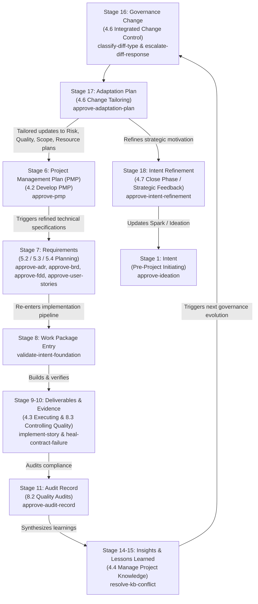

# Intent-to-Outcome Chain — PMBOK 8 Process Alignment and Closed-Loop Governance

Source of the 18-stage chain concept: SocialEngage's `Intent-to-Outcome-Chain-and-TaskPolicy-Coverage.md` (Obsidian Brain wiki) and the SIDPA Project Management Lifecycle.

In enterprise software engineering and agentic governance (PMBOK 8 / SIDPA), every stage that yields a documented artifact requires a formal Bayesian validation gate. We start with a **Spark** and systematically trace intent through execution, verification, governance amendment, behavioral adaptation, and back to refined intent—closing the complete development lifecycle loop.

All document-approval policies operate under `DecisionAuthority.FULL` using multi-criteria Bayesian evaluation (`DecisionFrame`), with human adjudication mandated (`requires_human_approval: true`).

---

## 1. Document Authoring Sequence vs. Conceptual Ontology

There is an important distinction between the abstract conceptual trace and the **actual document build sequence**:

* **Conceptual Ontology (`traceabilityChain`):**
  $$\text{Intent} \longrightarrow \text{Objective} \longrightarrow \text{Hypothesis} \longrightarrow \text{Benefit} \longrightarrow \dots$$
* **Actual Document Authoring & Governance Sequence (PMBOK 8 / SIDPA Lifecycle):**
  ```
  1. Spark Capture (Intent — Initiating)
         ↓
  2. Ideation Document (Hypotheses — Initiating)
         ↓
  3. Business Case & Benefits Statement (Benefit — Initiating)
         ↓
  4. Project Charter (Objective — Initiating: 4.1 Develop Project Charter)
         ↓
  5. Subsidiary Management Plans & Project Management Plan (Planning: 4.2 Develop PMP)
         ↓
  6. Technical Specifications: ADR → BRD → FDD → User Stories (Planning: 5.2/5.3/5.4)
         ↓
  7. Foundation Validation Gate (Planning → Executing Entry Gate)
         ↓
  8. Implementation & Verification (Executing: 4.3 & Monitoring & Controlling: 8.3)
         ↓
  9. Audit Record & Knowledge Synthesis (Monitoring & Controlling: 8.2 & 4.4)
         ↓
  10. Paired Governance Pipeline (Monitoring & Controlling: 4.6 Integrated Change Control)
         ↓
  11. Adaptation Plan (Adaptive Closing / Feedback: Tailoring PMP Updates)
         ↓
  12. Intent Refinement (Closing: 4.7 Close Phase & Strategic Feedback to Spark)
  ```

---

## 2. Complete 18-Stage Chain Coverage Matrix (PMBOK 8 Process Mapping)

| # | Chain Stage | PMBOK 8 Process Group | PMBOK 8 Process Number & Name | Governed Document Artifact | Assigned TaskPolicy | Authority & Decision Shape | Lifecycle Role & IPO |
|---|---|---|---|---|---|---|---|
| 1 | **Intent** | **Initiating** | Pre-Project: Strategic Need Identification | `Spark-Capture.md`<br>`Ideation-Document.md` | `template-governance` / **`approve-ideation`** | `FULL`<br>(3 actions: approve, reject, request revision) | **Starts with a Spark.** Inputs: Trigger event / strategic driver. Process: Validate intent. Output: Approved Ideation. |
| 2 | **Objective** | **Initiating** | 4.1 Develop Project Charter | `Project-Charter.md` | `template-governance` / **`approve-charter`** | `FULL`<br>(3 actions: approve, reject, request revision) | Inputs: Business Case & Benefits. Process: Authorize project & assign sponsor. Output: Project Charter. |
| 3 | **Hypothesis** | **Initiating** | Pre-Project: Design Assumption Formulation | `Ideation-Document.md`<br>(Hypothesis section / `HYP-*.md`) | `agent-learning-governance` / **`classify-hypothesis-status`** | `FULL`<br>(7 actions: advance to testing, mark validated, mark invalidated, etc.) | Inputs: Design assumptions & test logs. Process: Evaluate empirical evidence. Output: Validated / testing status. |
| 4 | **Benefit** | **Initiating** | Business Documents: Benefits Realization Planning | `Business-Case.md`<br>`Benefits-Statement.md` | `template-governance` / **`approve-business-case`** | `FULL`<br>(3 actions: approve, reject, request revision) | Inputs: Hypotheses & ROI premise. Process: Validate economics. Output: Benefits Statement (Input to Charter). |
| 5 | **Capability** | **Executing** | Capability Crystallization | Capability Matrix / Catalog | *Automated Synthesis* | Deterministic mapping | Inputs: Delivered code & modules. Process: Map skills & competencies. Output: Organizational Capabilities. |
| 6 | **Project** | **Planning** | 4.2 Develop Project Management Plan | `Project-Management-Plan.md`<br>& Subsidiary Plans | `template-governance` / **`approve-pmp`** | `FULL`<br>(3 actions: approve, reject, request revision) | Inputs: Project Charter & subsidiary plans. Process: Formalize baselines. Output: Approved Project Management Plan. |
| 7 | **Requirement** | **Planning** | 5.2 Collect Requirements & 5.3 Define Scope | Architecture & Specs:<br>• `ADR-*.md`<br>• `BRD-*.md`<br>• `FDD-*.md`<br>• `user-stories/*.md` | `template-governance` /<br>• **`approve-adr`**<br>• **`approve-brd`**<br>• **`approve-fdd`**<br>• **`approve-user-stories`** | `FULL`<br>(3 actions each: approve, reject, request revision) | Inputs: PMP Scope & Hypotheses. Process: Architectural & functional specification. Output: Approved ADR/BRD/FDD/Stories. |
| 8 | **Work Package** | **Planning → Executing** | 5.4 Create WBS & Sprint Gate | Epic / Sprint Backlog Entry | `template-governance` / **`validate-intent-foundation`** | `FULL`<br>(3 actions: accept, reject, flag) | Inputs: Approved requirements package. Process: Gate implementation entry. Output: Provisioned git worktree. |
| 9 | **Deliverable** | **Executing** | 4.3 Direct & Manage Project Work | Source Code & Release Artifacts | `implement-story` & `heal-contract-failure` | Direct Execution & Review | Inputs: Approved stories & acceptance criteria. Process: TDD / contract-first build. Output: Executable code deliverable. |
| 10 | **Verification Evidence** | **Monitoring & Controlling** | 8.3 Control Quality | Contract Tests & Execution Logs | Executable Test Suite | Input Evidence | Inputs: Code deliverable & contract tests. Process: Execute test suite. Output: Verification evidence report (pytest). |
| 11 | **Audit Record** | **Monitoring & Controlling** | 8.2 Manage Quality Audits | `Audit-Register.md`<br>`Audit-Finding.md` | `template-governance` / **`approve-audit-record`** | `FULL`<br>(3 actions: approve, reject, request revision) | Inputs: Deliverables & verification logs. Process: Audit architectural conformance. Output: Approved Audit Register entries. |
| 12 | **Actual Outcome** | **Monitoring & Controlling** | 5.5 Validate Scope & Value Realization | Post-Delivery Impact Assessment | *Empirical Observation* | Baseline Comparison | Inputs: Production telemetry & Benefits Statement. Process: Compare realized vs expected value. Output: Impact deltas. |
| 13 | **Observation** | **Monitoring & Controlling** | 4.5 Monitor & Control Project Work | Telemetry & Environment Gotchas | Knowledge Base Captures | Raw Input | Inputs: Runtime telemetry & review findings. Process: Record raw telemetry. Output: Uninterpreted observation log. |
| 14 | **Insight** | **Monitoring & Controlling** | 4.4 Manage Project Knowledge (Synthesis) | Synthesized Technical Findings | `obsidian-brain-ingestor` / **`resolve-kb-conflict`** | `FULL`<br>(trust existing, supersede, flag) | Inputs: Observation logs. Process: Synthesize causal significance. Output: Resolved insight node. |
| 15 | **Lesson Learned** | **Monitoring & Controlling** | 4.4 Manage Project Knowledge (Lessons Learned Register) | Formalized Organizational Knowledge | `obsidian-brain-ingestor` / **`resolve-kb-conflict`** | `FULL`<br>(trust existing, supersede, flag) | Inputs: Verified insights. Process: Crystallize actionable knowledge. Output: Formalized Lessons Learned register. |
| 16 | **Governance Change** | **Monitoring & Controlling** | 4.6 Perform Integrated Change Control | Governance Amendments & Diffs | `template-governance` /<br>• **`classify-diff-type`**<br>• **`escalate-diff-response`** | Paired Pipeline:<br>• `FULL` (7 diff classes)<br>• `LOW` (3 escalation actions) | Inputs: Lessons learned & proposed diffs. Process: Semantic classification & escalation bandit. Output: Governed baseline update. |
| 17 | **Adaptation** | **Closing / Adaptive Feedback** | 4.6 Perform Integrated Change Control (Tailoring) | `Adaptation-Plan.md` | `template-governance` / **`approve-adaptation-plan`** | `FULL`<br>(3 actions: approve, reject, request revision) | Inputs: Validated Stage 16 governance change. Process: Operationalize into skills/workflows. Output: **Tailored PMP updates**. |
| 18 | **Intent Refinement** | **Closing** | 4.7 Close Project or Phase (Cognitive Feedback) | `Intent-Refinement-Proposal.md` | `template-governance` / **`approve-intent-refinement`** | `FULL`<br>(3 actions: approve, reject, request revision) | Inputs: Adaptation results & realized outcomes. Process: Refine strategic motivation. Output: **Catalyst for next Spark Capture**. |

---

## 3. The Continuous Adaptation & PMP Feedback Cycle

When an operational gap, audit finding, or governance amendment occurs:



---

## 4. Directory Layout in This Template

```
sidpa-template/
├── docs/
│   ├── chain-coverage.md                         # This comprehensive coverage matrix
│   ├── project-docs/
│   │   ├── Spark-Capture.template.md              # Stage 1: Intent (Initiating)
│   │   ├── Ideation-Document.template.md          # Stage 1: Intent & Stage 3: Hypotheses (Initiating)
│   │   ├── Project-Charter.template.md            # Stage 2: Objective (Initiating: 4.1)
│   │   ├── Business-Case.template.md              # Stage 4: Benefit (Initiating)
│   │   ├── Benefits-Statement.template.md         # Stage 4: Benefit (Initiating)
│   │   ├── Project-Management-Plan.template.md    # Stage 6: PMP & Subsidiary Plans (Planning: 4.2)
│   │   ├── Adaptation-Plan.template.md            # Stage 17: Adaptation (Monitoring & Controlling / Tailoring)
│   │   ├── Intent-Refinement-Proposal.template.md # Stage 18: Intent Refinement (Closing: 4.7)
│   │   ├── Business-Requirements/
│   │   │   └── BRD-TEMPLATE.md                    # Stage 7: Requirement (Planning: 5.2/5.3)
│   │   └── Functional-Design/
│   │       └── FDD-TEMPLATE.md                    # Stage 7: Requirement (Planning: 5.3)
│   ├── 07-architecture/
│   │   └── ADR-TEMPLATE.md                        # Stage 7: Requirement (Planning: 5.3)
│   ├── user-stories/
│   │   └── EPIC-TEMPLATE.md                       # Stage 7: Requirement (Planning: 5.4)
│   ├── registers/
│   │   ├── Audit-Register.template.md             # Stage 11: Audit Record (Monitoring & Controlling: 8.2)
│   │   └── Story-Execution-Register.template.md   # Stage 9: Deliverable Tracking (Executing: 4.3)
│   └── policy-shapes/                             # Canonical JSON action shape specifications
│       ├── approve-ideation.actions.json
│       ├── approve-charter.actions.json
│       ├── classify-hypothesis-status.actions.json
│       ├── approve-business-case.actions.json
│       ├── approve-pmp.actions.json
│       ├── approve-adr.actions.json
│       ├── approve-brd.actions.json
│       ├── approve-fdd.actions.json
│       ├── approve-user-stories.actions.json
│       ├── validate-intent-foundation.actions.json
│       ├── approve-audit-record.actions.json
│       ├── classify-diff-type.actions.json
│       ├── escalate-diff-response.actions.json
│       ├── approve-adaptation-plan.actions.json
│       └── approve-intent-refinement.actions.json
└── data/agent-learning/store/                     # Pre-declared policies and active pointers
    ├── active-policies/template-governance/
    └── policies/template-governance/
```
