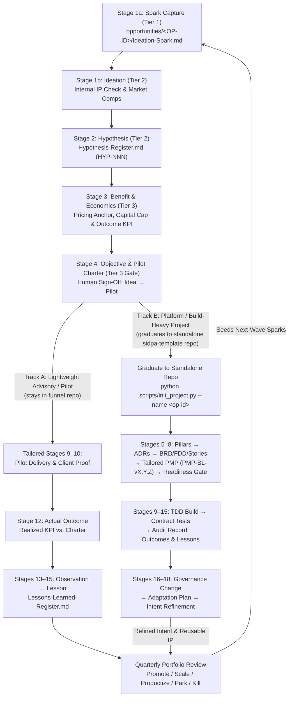

# Example: Tailored Hybrid SIDPA Governance (Lightweight Funnel → Full Project Maturity)

> **Labeling Contract:** Illustrative tailoring pattern — **not** empirical evidence and **not** a governed project instance.  
> **Originating Reference Case:** Adapted from [`mdresch/oppurtunities-2027`](https://github.com/mdresch/oppurtunities-2027) *(exact GitHub repository slug)* (a 117-opportunity zero-working-capital consulting portfolio operating under a 10–15 hrs/week cap), applying `docs/sequence-and-lessons.md` Rules #18, #23–24, #30, and #32.

---

## 1. When to Use This Tailored Hybrid Pattern

Full 18-stage SIDPA governance (9 subsidiary management plans, ADRs, BRDs, FDDs, User Stories, and Bayesian `agent-learning` TaskPolicies) is designed for **active software or platform build projects**. Applying that full scaffold prematurely to an **opportunity funnel**, **early-stage ideation portfolio**, or **small advisory pilot** creates governance bloat and violates Rules #18, #30, and #32.

Use this **Tailored Hybrid** pattern when:
- You are managing a **multi-opportunity funnel** (dozens of `Spark` ideas) where only a small fraction will ever graduate to active execution.
- You operate under a **tight time or zero-capital constraint** where effort must stay focused on market validation and fast pilots.
- Some validated opportunities will remain **lightweight advisory / non-code engagements (Track A)** while others will mature into **platform-backed or build-heavy engineering projects (Track B)**.

### What This Pattern Is Not
- **Not a bypass of SIDPA invariants:** Human adjudication (`requires_human_approval: true`), Negative Scope Boundaries, Problem-Before-Solution, Non-Duplication, Honest Evidence Baseline, and Two-Loop Separation still apply in full.
- **Not a justification for copying 9 subsidiary plans or policy stores into Spark folders.** Keep Stages 1–4 ultra-lightweight; instantiate `scripts/init_project.py` only when an opportunity graduates to Track B.

---

## 2. Minimal Repo Footprint for a Lightweight Funnel

A lightweight SIDPA funnel repository needs only **five governance artifacts** (no `data/agent-learning/store/` until a repeating gate decision justifies one per Rule #18):

1. **Governance Reference:** `docs/governance/Tailored-Hybrid-SIDPA-Governance.md` (adapted from this example).
2. **Agent QA Rules:** `.claude/rules/sidpa-portfolio-qa.md` (the 5 non-code invariants from `.github/instructions/sidpa-governance-qa.instructions.md`).
3. **Live Orientation Register:** `docs/registers/Portfolio-Status-Register.md` (adapted from `docs/registers/Project-Status-Register.template.md` — live "where are we now" snapshot + `BFI-NNN` design-time baseline feedback table).
4. **Stage 2 Hypothesis Register:** `docs/registers/Hypothesis-Register.md` (adapted from `docs/registers/Hypothesis-Register.template.md` — falsifiable commercial/technical assumptions).
5. **Stage 15 Lessons Learned Register:** `docs/registers/Lessons-Learned-Register.md` (adapted from `docs/registers/Lessons-Learned-Register.template.md` — append-only empirical execution lessons).

---

## 3. End-to-End Hybrid Lifecycle Architecture

---

## 4. Funnel Stages & Completion Gates (Stages 1–4)

All opportunities start at **Stage 1a**. Only shortlisted candidates invest effort in Stages 1b–4.

### Stage 1a — Spark Capture (`Tier 1: Macro Signal Check`)
- **PMBOK 8 Alignment:** Initiating — Pre-Project / Strategic Need Identification.
- **Artifact:** `opportunities/<OP-ID>/Ideation-Spark.md` + master inventory row.
- **Completion Gate (`G1a`):**
  - [ ] Dedicated workspace folder exists and is indexed.
  - [ ] Problem stated before solution; explicit negative scope boundary ("What this is not yet").
  - [ ] No premature architecture, database schemas, or subsidiary plans collapsed into the Spark.
  - [ ] Inventory `Status` remains `Idea` (or `Parked`).

### Stage 1b — Ideation (`Tier 2: Deeper Research & Comparables`)
- **PMBOK 8 Alignment:** Initiating — Opportunity Framing.
- **Artifact:** `opportunities/<OP-ID>/Ideation-Document.md` (and optional client-facing one-pager).
- **Completion Gate (`G1b`):**
  - [ ] Existing reusable IP/assets verified (not assumed).
  - [ ] 2–3 real market comparables (pricing, buyer persona, packaging) benchmarked.
  - [ ] Differentiation and explicit non-overlap boundaries documented.

### Stage 2 — Hypothesis (`Tier 2: Falsifiable Assumptions`)
- **PMBOK 8 Alignment:** Initiating — Assumption Formulation.
- **Artifact:** Entry (`HYP-<portfolio>-NNN`) in `docs/registers/Hypothesis-Register.md`.
- **Completion Gate (`G2`):**
  - [ ] At least one falsifiable Value, Packaging, or Technical hypothesis logged with explicit **Falsification Criteria**.
  - [ ] Status starts honestly as `Formulated` (never marked `Validated` without real external evidence).
  - [ ] *Rule #5:* Untested hypotheses are never treated as settled requirements.

### Stage 3 — Benefit & Economics (`Tier 3: Commercial Viability`)
- **PMBOK 8 Alignment:** Initiating — Benefits Realization Planning (Charter Input — Rule #1).
- **Artifact:** Benefits & Economics section in `Pilot-Charter.md` (or standalone `Business-Case.md`).
- **Completion Gate (`G3`):**
  - [ ] Resource/capital constraints verified (e.g., \$0 cash outlay, hours/week cap).
  - [ ] Pricing anchor and single measurable outcome KPI defined.
  - [ ] Reinvestment / compounding path (case study, reusable IP, retainer) stated.

### Stage 4 — Objective & Pre-Pilot Charter (`Tier 3 Gate: Idea → Pilot`)
- **PMBOK 8 Alignment:** Initiating — 4.1 Develop Project Charter.
- **Artifact:** `opportunities/<OP-ID>/Pilot-Charter.md` (1–2 pages) + status updated to `Pilot`.
- **Completion Gate (`G4` · `requires_human_approval: true`):**
  - [ ] Scope, deliverables, and **explicit out-of-scope boundaries** finalized.
  - [ ] Named pilot sponsor/prospect or concrete outreach campaign exists.
  - [ ] **Execution Track explicitly chosen:** **Track A (Lightweight Advisory)** or **Track B (Graduated `sidpa-template` Build)**.
  - [ ] **Sponsor/Director sign-off recorded** before changing inventory status from `Idea` → `Pilot`.

---

## 5. Post-Charter Execution Tracks (Tailoring Split)

### Track A: Lightweight Advisory / Pilot *(Stays in Funnel Repo)*
Best for diagnostics, advisory sprints, assessments, and non-code deliverables:

| Tailored Stage | Artifact | Completion Gate |
| --- | --- | --- |
| **Stages 9–10: Delivery & Proof** | Client deliverable(s) + delivery checklist against `Pilot-Charter.md` | Client accepts deliverable; scope boundaries respected; actual hours & revenue logged. |
| **Stage 12: Actual Outcome** | Post-pilot outcome summary (actuals vs. Charter KPI) | Honest variance recorded; `HYP-*` status updated in `Hypothesis-Register.md`. |
| **Stages 13–15: Observation → Lesson** | Entry (`LL-NNN`) in `Lessons-Learned-Register.md` | Root cause & actionable rule approved; cross-project lessons synced to shared knowledge base (Rule #21). |
| **Quarterly Review (Tailored Stages 17–18)** | Updated `Portfolio-Status-Register.md` & inventory | Explicit disposition: **Scale / Productize**, **Graduate to Track B**, **Park**, or **Kill**. |

*Deliberately omitted on Track A:* Pillars Exercise, ADRs, BRD/FDD/User Stories, 9 PMBOK subsidiary plans, Foundation Packs, and Bayesian policy stores.

### Track B: Graduated Platform / Build-Heavy Project *(Standalone `sidpa-template` Repo)*
Best for software platforms, multi-agent systems, or multi-epic product builds:

**Graduation Gate (`G4-B`):**
1. Instantiate a standalone repository from `sidpa-template` and run `python scripts/init_project.py --name <project-name> --opportunity-id <OP-ID> --portfolio-repo <org/portfolio-repo>`.
2. Seed its Stage 1–4 artifacts from `opportunities/<OP-ID>/` (citing upstream, no duplication).
3. Record the graduated repo URL and `docs/registers/Project-Status-Register.md` pointer in the funnel’s `Portfolio-Status-Register.md`.
4. **Non-Duplicating Rollup Reporting:** Keep all ADRs, stories, subsidiary plans, gate JSONs, and execution queues exclusively in the graduated repo. At macro gate crossings only (**Stage 8** authorization, **Phase/Epic completion / Stage 11 Audit**, and **Stage 12/18** close), run `python scripts/export_portfolio_rollup.py` to emit the 5-field executive rollup row (`Opportunity ID`, `Graduated Repo SSOT`, `Macro Stage & Baseline`, `Coarse Delivery Progress`, `Commercial / Pilot Status`) for the upstream portfolio register.
5. Execute full **Stages 5–18** per [docs/chain-coverage.md](../chain-coverage.md):
   - **Stage 5:** Pillars Exercise (`PILLARS-EXERCISE.md`, `Project-Pillars.md`) + foundational ADRs (100% pillar coverage)
   - **Stage 6:** Tailored Subsidiary Plans + Integrated PMP (`PMP-BL-vX.Y.Z`; Foundation Packs only when justified — Rule #30)
   - **Stage 7:** Strict `ADR → BRD → FDD → User Stories` sequence (User Stories = PMBOK Work Packages)
   - **Stage 8:** Implementation Readiness Gate (`validate-intent-foundation`)
   - **Stages 9–11:** Contract-first TDD (`implement-story`), full regression suite (Rule #26), and `Audit-Register.md`
   - **Stages 12–18:** Outcomes, Observations/Lessons (shared KB), Stage 16 Governance Change, Stage 17 Adaptation Plan, and Stage 18 Intent Refinement feeding back into the parent portfolio’s Quarterly Review.

---

## 6. Two-Loop Change Control (Design-Time vs. Execution)

Keep the two feedback loops strictly separate (per [docs/chain-coverage.md §3 & §3.1](../chain-coverage.md)):

| Loop | Trigger (`evidence_basis`) | Where Logged | Rule |
| --- | --- | --- | --- |
| **Design-Time Loop** | Cross-doc contradictions, ranking/quarter mismatches, or scope flags found *before* pilot execution (`design_time`) | `BFI-NNN` table in `Portfolio-Status-Register.md` | Patch-level reconciliation only; never logged as a Lesson Learned; never invents evidence. |
| **Execution Loop** | Real buyer feedback, pilot delivery actuals, or audit findings (`execution`) | `Lessons-Learned-Register.md` + `Hypothesis-Register.md` | Append-only; informs Quarterly Review and Tier 2/3 rule propagation. |
