# 🧠 Second Brain 18-Stage Lifecycle & Script Toolchain Guide

> **Synthetic Intent-Driven Process Architecture (SIDPA) × Second Brain Cybernetic Loop**  
> *Grounded in PMI-PMBOK 8th Ed., IIBA-BABOK v3, DAMA-DMBOK2, W3C PROV-O, and `ONTOLOGY.json` (v1.1.0-LOCKED)*

This guide provides the complete, authoritative operational roadmap for traversing all **18 stages** of closed-loop software engineering and governance, utilizing the turnkey **Second Brain script toolchain** bundled in `scripts/brain/`.

---

## 1. Dual-Locus Architecture: Codebase vs. Second Brain

In enterprise agentic engineering, knowledge and execution are decoupled into two synchronized loci:

| Locus | Location | Primary Role | Core Artifacts |
|---|---|---|---|
| **Project Repository** | e.g. `enterprise-work-hierarchy/` | Concrete execution, contract tests, production code, PMP baselines | `docs/project-docs/`<br>`docs/07-architecture/`<br>`docs/registers/`<br>`src/` & `tests/` |
| **Obsidian Second Brain** | `obsidian-second-brain/wiki/` | Cross-project institutional memory, ontological graph, telemetry, cognitive synthesis | `00 Intent & Charter/`<br>`01 Architecture Decisions (ADR)/`<br>`06 Synthesis & Lessons Learned/`<br>`_MOCs/` |

The two loci form a **closed cybernetic loop**:
- Intent flows **forward** from Spark to Deliverables and Verification Evidence.
- Telemetry, observations, and insights flow **inward** to the Second Brain.
- Lessons learned and adaptations flow **backward** to refine future Intent and amend ADRs.

---

## 2. The 4 Cybernetic Phases & 18 Governed Stages

```mermaid
flowchart LR
    subgraph P1["Phase 1: Inception & Strategy"]
        S1["1. Spark & Intent"] --> S2["2. Research & Concepts"]
        S2 --> S3["3. Business Case & ROI"]
        S3 --> S4["4. Project Charter"]
        S4 --> S5["5. Pillars & ADRs"]
    end
    subgraph P2["Phase 2: Specification & Planning"]
        S5 --> S6["6. Requirements (BRD/FDD)"]
        S6 --> S7["7. User Stories (Work Packages)"]
        S7 --> S8["8. PMP & Baselines"]
        S8 --> S9["9. Readiness Gate"]
    end
    subgraph P3["Phase 3: Execution & Telemetry"]
        S9 --> S10["10. Deliverable Code"]
        S10 --> S11["11. Contract Tests"]
        S11 --> S12["12. Quality Audit"]
        S12 --> S13["13. Telemetry (OBS)"]
        S13 --> S14["14. Empirical Outcome"]
    end
    subgraph P4["Phase 4: Synthesis & Adaptation"]
        S14 --> S15["15. Diagnostic Insights"]
        S15 --> S16["16. Lessons Learned"]
        S16 --> S17["17. Governance Change"]
        S17 --> S18["18. Adaptation & Intent Refinement"]
    end
    S18 -->|"refinesIntent (Step 19)"| S1
    S17 -.->|"amendsADR (Fast-Path)"| S5
```



### Phase 1: Inception, Concept Research & Architectural Decisions (Stages 1–5)

* **Stage 1: Strategic Intent & Spark Capture (`Spark-Capture.md`, `Ideation-Document.md`)**
  - **Class**: `Intent` / `StrategicIntent`
  - **Process**: Pre-Project strategic need articulation; define the "Why" and state what the project intentionally *is not yet*.
  - **Policy**: `approve-ideation` (`DecisionAuthority.FULL`)
  - **Tooling**: `scripts/brain/run-lifecycle-pipeline.mjs --stage 1`
  - **Exit Gate**: Formulated testable hypothesis with bounded strategic value proposition.

* **Stage 2: Feature Research & Concept Grounding (`Concept-*.md`)**
  - **Class**: `DomainKnowledge` / `GovernanceArtifact`
  - **Process**: Review historical Second Brain notes (2,800+ notes across DMBOK2); 5-facet inquiry and authority scoring.
  - **Tooling**: `scripts/brain/query-knowledge-graph.mjs`, `scripts/brain/ground-adrs-to-concepts.mjs`
  - **Exit Gate**: Conceptual taxonomy verified against DAMA-DMBOK2 standards.

* **Stage 3: Business Case & Benefits Statement (`Business-Case.md`, `Benefits-Statement.md`)**
  - **Class**: `BusinessCase` / `Benefit`
  - **Process**: Benefits realization planning; commercial viability and target ROI threshold ($>20\%$).
  - **Policy**: `approve-business-case` (`DecisionAuthority.FULL`)
  - **Exit Gate**: Approved commercial ROI threshold and ratified Benefits Register (`BEN-*`).

* **Stage 4: Project Charter & Hypothesis Formulation (`Project-Charter.md`, `HYP-*.md`)**
  - **Class**: `Project` / `Hypothesis`
  - **Process**: PMBOK 4.1 Develop Project Charter; assign project sponsor and lead architect; bound SMART objectives.
  - **Policy**: `approve-charter` (`DecisionAuthority.FULL`)
  - **Exit Gate**: Project Charter formally signed off; architectural hypotheses locked.

* **Stage 5: Pillars Exercise & High-Level ADRs (`PILLARS-EXERCISE.md`, `ADR-*.md`)**
  - **Class**: `GovernanceArtifact (Decision)`
  - **Process**: PMBOK 5.3 Define Scope (Architectural Strategy); decompose Charter into 4–6 MECE pillars; formulate ADRs providing **100% pillar coverage**.
  - **Policy**: `approve-adr` (`DecisionAuthority.FULL`)
  - **Tooling**: `scripts/brain/ground-adrs-to-concepts.mjs`
  - **Exit Gate**: Status = `Accepted`; Adversarial Decision Inversion passes 100%.

---

### Phase 2: Specification, Work Packages, Management Plans & Baselines (Stages 6–9)

* **Stage 6: Technical Requirements & Functional Specifications (`BRD-*.md`, `FDD-*.md`, `TDS-*.md`)**
  - **Class**: `Requirement` / `TechnicalDesign`
  - **Process**: PMBOK 5.2 Collect Requirements & BABOK RADD; establish sequence flows, state machines, and contract definitions.
  - **Policies**: `approve-brd`, `approve-fdd` (`DecisionAuthority.FULL`)
  - **Exit Gate**: Functional boundaries, error cascades, and DDL locked.

* **Stage 7: Work Package Decomposition & User Stories (`docs/user-stories/*.md`)**
  - **Class**: `Requirement` / `WorkPackage` (PMBOK 5.4 WBS)
  - **Process**: Decompose FDD specs into atomic User Stories with Given/When/Then (BDD) acceptance criteria.
  - **Rule (Invariant 3)**: User Stories *are* the work packages that ground subsidiary plan baselines.
  - **Policy**: `approve-user-stories` (`DecisionAuthority.FULL`)
  - **Exit Gate**: INVEST criteria satisfied; story points and task dependencies assigned.

* **Stage 8: Subsidiary Management Plans & Integrated PMP (`Project-Management-Plan.md`)**
  - **Class**: `Project` / `GovernanceArtifact`
  - **Process**: PMBOK 4.2 Develop PMP; integrate 9 subsidiary plans (Scope 5.1/7.A, Schedule 6.1/7.B, Cost 7.1/7.D, Resource 9.1/7.C, Quality 8.1, Risk 11.1, etc.).
  - **Policy**: `approve-pmp` (`DecisionAuthority.FULL`)
  - **Tooling**: `python scripts/orchestrate_pmbok.py --mode full`
  - **Exit Gate**: Immutable SemVer baseline locked (`PMP-BL-v1.0.0`); triple baselines grounded.

* **Stage 9: Implementation Readiness Gate (`Stage-8-Implementation-Authorization-Notice.md`)**
  - **Class**: `QualityGate` / `ExecutionAuthorization`
  - **Process**: Reconcile all Stage 6 requirements approvals and Stage 8 PMP baseline before developers write production code.
  - **Policy**: `validate-intent-foundation` (`DecisionAuthority.FULL`)
  - **Exit Gate**: Formally authorizes worktree provisioning, staffing, and build execution.

---

### Phase 3: Execution, Verification Evidence & Empirical Telemetry (Stages 10–14)

* **Stage 10: Deliverable Code Implementation (`src/` / `server/`)**
  - **Class**: `Deliverable`
  - **Process**: PMBOK 4.3 Direct & Manage Project Work; contract-first test-driven development (TDD).
  - **Tooling**: `.claude/skills/implement-story`
  - **Exit Gate**: Clean compilation, zero lint errors, all unit tests passing.

* **Stage 11: Verification Evidence & Executable Test Suites (`tests/`)**
  - **Class**: `VerificationEvidence` / `QualityGate`
  - **Process**: PMBOK 8.3 Control Quality; execute 4-Ring verification (Contract, Suite Regression, Schema Invariants, Integration).
  - **Tooling**: `.claude/skills/heal-contract-failure`
  - **Exit Gate**: 100% contract test pass rate; zero schema drift.

* **Stage 12: Architectural Conformance Audit (`Audit-Register.md`)**
  - **Class**: `AuditRecord`
  - **Process**: PMBOK 8.2 Manage Quality Audits; verify deliverables against ADR constraints and governance invariants.
  - **Policy**: `approve-audit-record` (`DecisionAuthority.FULL`)
  - **Exit Gate**: Audit finding entry signed off in `docs/registers/Audit-Register.md`.

* **Stage 13: Runtime Telemetry & Raw Empirical Observations (`OBS-*.md`)**
  - **Class**: `Observation`
  - **Process**: PMBOK 4.5 Monitor & Control Project Work; capture runtime telemetry,Gotchas, CI friction, and environment drift.
  - **Second Brain Ingestion**: Author atomic `OBS-<PROJECT>-<NNN>.md` in `06 Synthesis & Lessons Learned/` and index in master register.
  - **Tooling**: `npm run brain:heal`
  - **Exit Gate**: Unfiltered observation log ingested; zero broken wikilinks.

* **Stage 14: Empirical Outcome & Impact Realization (`OUTCOME-*.md`)**
  - **Class**: `Outcome` / `AffectMeasurement`
  - **Process**: PMBOK 5.5 Validate Scope & Value Realization; compare actual outcomes against Stage 3 Benefits Statement and Stage 4 Hypotheses.
  - **Exit Gate**: Quantifiable delta measured; developer cognitive affect recorded.

---

### Phase 4: Cognitive Synthesis, Adaptation & Loop Closure (Stages 15–18)

* **Stage 15: Diagnostic Findings & Causal Insights (`INSIGHT-*.md`)**
  - **Class**: `Insight`
  - **Process**: PMBOK 4.4 Manage Project Knowledge (Synthesis); synthesize root-cause mechanics from Stage 13 raw telemetry.
  - **Tooling**: `scripts/brain/synthesis-validator.mjs`
  - **Exit Gate**: Root-cause failure mode identified; schema conformance verified.

* **Stage 16: Crystallized Lessons Learned (`LL-*.md`, `Lessons-Learned-Register.md`)**
  - **Class**: `LessonLearned` / `KnowledgeAsset`
  - **Process**: PMBOK 4.4 Manage Project Knowledge; crystallize actionable, immutable rules preventing institutional amnesia.
  - **Exit Gate**: Codified into living agent instructions, skills, or `docs/sequence-and-lessons.md`.

* **Stage 17: Governance Change & Integrated Change Control (`GC-*.md`, `Adaptation-Plan.md`)**
  - **Class**: `GovernanceChange` / `Adaptation`
  - **Process**: PMBOK 4.6 Perform Integrated Change Control & Tailoring; evaluate change impact across subsidiary plans.
  - **Policies**: `classify-diff-type`, `escalate-diff-response`, `approve-adaptation-plan`
  - **Tooling**: `python scripts/orchestrate_pmbok.py --mode adapt`
  - **Exit Gate**: Ratified adaptation plan; selective subsidiary plan re-orchestration.

* **Stage 18: Emergent Capability & Intent Refinement (`Intent-Refinement-Proposal.md`)**
  - **Class**: `Capability` / `IntentRefinement`
  - **Process**: PMBOK 4.7 Close Project or Phase; evaluate whether realized outcomes alter original strategic motivations.
  - **Policy**: `approve-intent-refinement` (`DecisionAuthority.FULL`)
  - **Loop Closure (Step 19)**: Refined intent seeds the **Stage 1 Spark** for Phase N+1; fast-path amends originating Stage 5 ADRs.
  - **Exit Gate**: 100% closed cybernetic return loop. Zero unclosed cognition loops.

---

## 3. Second Brain Script Toolchain Reference

All Second Brain scripts in `scripts/brain/` run out of the box with zero external npm dependencies using native Node.js (ES modules):

| Command / Script | Primary Role | When to Run | Target Outputs |
|---|---|---|---|
| `npm run lifecycle` | Master 18-stage pipeline runner | After every milestone or stage completion | 18-stage conformance report |
| `npm run lifecycle:vault` | Validates multi-project conformance in Obsidian | During cross-project synthesis | Vault project audit report |
| `npm run brain:heal` | Self-healing wikilink & alias resolver | After creating or editing markdown notes | Heals broken links, updates aliases |
| `npm run brain:diagnose` | Broken link diagnostic scanner | When broken wikilinks are suspected | List of unresolved link targets |
| `npm run brain:compile` | Ontology graph compiler | Prior to releases & after synthesis | Health score, closed/open loops |
| `npm run brain:analyze` | Graph topology & centrality analyzer | To evaluate architectural hubs & authorities | Degree distribution, top concepts |
| `npm run brain:validate` | Synthesis & decision inversion validator | When authoring new Concept notes | Frontmatter conformance audit |
| `npm run brain:drift` | Ontology & version drift detector | In pre-commit hooks and CI gates | Drift report vs `ONTOLOGY.json` |
| `npm run brain:canvas` | Generates 2D visual Obsidian canvas | For spatial visualization in Obsidian | `18-Stage-Closed-Loop-Lifecycle.canvas` |
| `npm run brain:ground` | ADR to ontology concept grounder | After accepting new ADRs | Bidirectional ADR-to-concept links |
| `npm run brain:query` | High-speed knowledge graph query CLI | For researching prior architectural decisions | Instant trace and relationship queries |

---

## 4. How to Follow the Path: Step-by-Step Execution Guide

When developing a project bootstrapped from `sidpa-template`:

1. **Initialize Project:**
   ```bash
   python scripts/init_project.py --name my-project
   ```
2. **Phase 1 (Inception):**
   - Author `Spark-Capture.md` and `Ideation-Document.md` (Stage 1).
   - Query Second Brain concepts: `npm run brain:query -- --search "architecture"`.
   - Ratify `Business-Case.md` (Stage 3) and `Project-Charter.md` (Stage 4).
   - Complete `PILLARS-EXERCISE.md` and draft foundational ADRs (Stage 5).
   - Ground ADRs: `node scripts/brain/ground-adrs-to-concepts.mjs --execute`.
3. **Phase 2 (Planning & Baselines):**
   - Author BRD, FDD, and User Stories (Stages 6–7).
   - Generate subsidiary plans & PMP: `python scripts/orchestrate_pmbok.py --mode full` (Stage 8).
   - Issue Implementation Authorization Notice (Stage 9).
4. **Phase 3 (Execution & Telemetry):**
   - Build story work packages: implement code and unit tests (Stage 10).
   - Execute contract test suite and 4-ring verification (Stage 11).
   - Log audit entries in `Audit-Register.md` (Stage 12).
   - Record telemetry in `OBS-*.md` (Stage 13).
   - Measure impact in `OUTCOME-*.md` (Stage 14).
5. **Phase 4 (Synthesis, Adaptation & Loop Closure):**
   - Run healing pass: `npm run brain:heal`.
   - Synthesize diagnostic insights: `INSIGHT-*.md` (Stage 15).
   - Crystallize lessons learned: `LL-*.md` and update `sequence-and-lessons.md` (Stage 16).
   - Formulate `Adaptation-Plan.md` and re-orchestrate impacted plans: `python scripts/orchestrate_pmbok.py --mode adapt` (Stage 17).
   - Draft `Intent-Refinement-Proposal.md` to feed Phase N+1 (Stage 18).
6. **Verify 100% Loop Closure:**
   ```bash
   npm run lifecycle
   ```
   Confirm all 18 stages pass with 100% verification and 0 open cognition loops.
